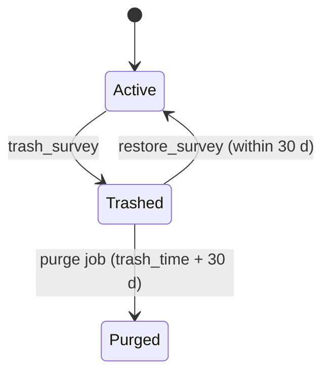

<!--
  Copyright 2026 The Ground Authors.

  Licensed under the Apache License, Version 2.0 (the "License");
  you may not use this file except in compliance with the License.
  You may obtain a copy of the License at

      https://www.apache.org/licenses/LICENSE-2.0

  Unless required by applicable law or agreed to in writing, software
  distributed under the License is distributed on an "AS IS" BASIS,
  WITHOUT WARRANTIES OR CONDITIONS OF ANY KIND, either express or implied.
  See the License for the specific language governing permissions and
  limitations under the License.
-->

# User Data Service: Cloud Spanner Schema

Authors: [Gino Miceli](https://github.com/gino-m) \
Status: Draft for review \
Last modified: 2026-10-18

## Summary

Back the user data RPCs with Spanner, with a small set of contract changes
listed under [Implementation Plan](#implementation-plan). Each synced record is
stored in a typed `PROTO` column. Every column Spanner keys, filters, or sorts
on is a `STORED` generated column derived from that proto. Primary keys are
client-generated UUIDs stored in the native `UUID` type, and surveys are the
main interleaving root. A commit-timestamp column on every synced table, plus
`(scope…, CommitTs, Id)` interleaved indexes, turns delta mode into cheap range
scans. Sync tokens are anchored on Spanner **read timestamps**, which keeps them
gap-free. Replays are detected with one `client_seq` watermark per client and
scope; no mutation log is stored.

This design builds on [sync-engine.md](../sync-engine.md),
[data_service.proto](../../../shared/protos/data/data_service.proto),
[survey_service.proto](../../../shared/protos/survey/survey_service.proto),
[organization_service.proto](../../../shared/protos/survey/organization_service.proto),
[library_service.proto](../../../shared/protos/library/library_service.proto),
[UserDataBackend.kt](../../../server/user-data-service/src/main/kotlin/org/groundplatform/v2/server/userdata/UserDataBackend.kt),
[SyncLists.kt](../../../server/user-data-service/src/main/kotlin/org/groundplatform/v2/server/userdata/SyncLists.kt).

## Decisions

| Topic                        | Decision                                                                                                                                                                                                                                                                                                                                                                                                                                                                |
| :--------------------------- | :---------------------------------------------------------------------------------------------------------------------------------------------------------------------------------------------------------------------------------------------------------------------------------------------------------------------------------------------------------------------------------------------------------------------------------------------------------------------- |
| Auth identity                | **Firebase Auth**. `UserId` is the Firebase `uid`.                                                                                                                                                                                                                                                                                                                                                                                                                      |
| Environment                  | **Cloud Spanner emulator for now.** No region or instance sizing yet. The schema is region-agnostic, and deployment choices are deferred until a real instance is needed.                                                                                                                                                                                                                                                                                               |
| Survey deletion              | **No hard deletes.** Deleting moves a survey to **Trash**. It can be restored for 30 days, then it's purged automatically. The proto changes accordingly.                                                                                                                                                                                                                                                                                                               |
| Record storage               | **`PROTO` columns** with generated columns.                                                                                                                                                                                                                                                                                                                                                                                                                             |
| Replay detection             | **Watermark only**: `ClientMutationWatermarks`. No mutation log, no `AppliedMutations`.                                                                                                                                                                                                                                                                                                                                                                                 |
| Share links                  | **The link is the survey URL**, `https://<host>/s/<survey_id>`, which opens in any browser (and in the app through App Links / Universal Links when installed). No separate link token or header: under `ANYONE_WITH_LINK`, knowing the survey's UUID is the link.                                                                                                                                                                                                      |
| IDs                          | **Every record ID is a UUID**: surveys, organizations (the global one has the reserved ID `00000000-0000-4000-8000-000000000001`), entities, submissions, impact events, and clients. Clients generate v4 (or v5) IDs offline. Dataset, form, and library entry IDs stay human-readable keys inside their survey or library, because XLSForm/ODK reference datasets and forms by name and library IDs are namespaced (`eudr.commodity`, `org.<organizationId>.<name>`). |
| Tombstones                   | **Permanent.** Deleted records keep a minimal row (keys, revision, `is_deleted`, `CommitTs`); their payload is pruned. Sync tokens never expire because tombstones are gone.                                                                                                                                                                                                                                                                                            |
| Upload watermarks            | **One-year TTL since last write**, and the web app keeps its `client_id` in `localStorage`.                                                                                                                                                                                                                                                                                                                                                                             |
| Failed uploads               | **Retry** or **Download PDF** in Uploads; no data export.                                                                                                                                                                                                                                                                                                                                                                                                               |
| Orgs and libraries on mobile | **Not on mobile.** Downloads store only the organization settings they need, such as imagery sources.                                                                                                                                                                                                                                                                                                                                                                   |
| Sharing role                 | **`SurveyAcl.sharing_role`** (`VIEWER` / `DATA_COLLECTOR`, default collector) for everyone with access through `sharing_policy`.                                                                                                                                                                                                                                                                                                                                        |
| Accounts                     | **Signed-in Firebase accounts required** for every RPC, including public and link surveys; no anonymous users. Email/password sign-up is enabled for participants without Google accounts.                                                                                                                                                                                                                                                                              |
| ACL ownership                | **Only organizers add or remove ACL entries.** `PUBLIC` and `ANYONE_WITH_LINK` grant access by policy, checked on every request, and never create ACL rows.                                                                                                                                                                                                                                                                                                             |
| Mobile sync scope            | **Explicit Download, per-survey scope.** Only downloaded surveys sync, each in full (definition, entities, submissions); no area or dataset sub-scopes. The survey list syncs only while its page is open.                                                                                                                                                                                                                                                              |

## Requirements From the Existing Contract

| Requirement (already specified)                                                                                     | What the schema must provide                                                                                                                     |
| :------------------------------------------------------------------------------------------------------------------ | :----------------------------------------------------------------------------------------------------------------------------------------------- |
| Client-defined IDs (`SurveyDef.survey_id` "RFC 4122 v4", entity/submission/event IDs created offline)               | `UUID` key columns, server-side validation, and existence checks inside the write transaction                                                    |
| Delta mode: every record in scope changed after `(commit_ts, id)`, in commit order, tombstones included             | A commit-timestamp column per synced row, plus an index led by scope fields and then `(CommitTs, Id)`                                            |
| Query mode: every page reads the same pinned snapshot                                                               | Stale reads at a pinned read timestamp, within `version_retention_period`                                                                        |
| Tombstones for deleted records; lost access detected                                                                | Soft-deleted entity and submission rows with a TTL, per-user `AccessEpoch` for list tokens, and `BatchGetSurveyOverviews` for downloaded surveys |
| Each mutation applied at most once; highest applied `client_seq` per `(client_id, scope)` for `GetAppliedMutations` | One `ClientMutationWatermarks` row per client and scope, updated in the same transaction as the mutation                                         |
| Strictly increasing versions (`revision`, `version`, `record_version`)                                              | Proto fields incremented inside each read-write transaction                                                                                      |
| Last-writer-wins field patches using the shared `org.groundplatform.v2.core.mutation` functions                     | Read the proto, apply the patches, write it back, all in one read-write transaction (no patch logic in SQL)                                      |
| `FAILED_PRECONDITION` when a token can't be served                                                                  | Data epoch and per-user / per-survey access epochs, carried in the token; tombstones are permanent, so tokens never expire                       |
| Stateless, any instance serves any request (Cloud Run)                                                              | No in-process state; drop `--max-instances 1`                                                                                                    |

## Key Design Decisions

### Client-Generated UUID Keys

Every record that clients can create offline is keyed by an ID the client chose.
This makes retried creates idempotent for free, but the server must not trust
those IDs blindly.

- **Native `UUID` type.** Keys are stored as 16-byte `UUID` values instead of
  `STRING(36)`. Spanner accepts the canonical text form as input. This matters
  most in survey-scoped indexes, which repeat `SurveyId` plus `EntityId` or
  `SubmissionId` in every entry. Protos keep IDs as strings, and the server
  converts at the storage boundary.
- **Validate the version.** Accept only random or hash-based UUIDs from clients
  and server alike: **v4** for IDs created offline, and **v5** for deterministic
  IDs derived from external keys (for example, CEO plot IDs on import, so
  re-imports are idempotent). Reject v1, v6, v7, and anything malformed with
  `INVALID_ARGUMENT`. Time-ordered IDs leading a top-level key (`Surveys`,
  `ImpactEvents`) would concentrate writes on one split.
- **Normalize to lowercase canonical text** whenever an ID is copied back into a
  proto or a sync token, so equality checks never depend on how the client
  formatted it.
- **Survey-scoped uniqueness.** Entities and submissions are keyed
  `(SurveyId, EntityId)` and `(SurveyId, SubmissionId)`, so a client ID only
  needs to be unique within its survey. Top-level IDs (`SurveyId`,
  `OrganizationId`, `EventId`) need global uniqueness, which v4 provides in
  practice.
- **Server-generated IDs stay server-side.** `AuditId` is server-generated.
  Revision numbers are server-assigned. Invite tokens come from a secure random
  generator and are never accepted from clients.

#### Create vs. Update Authorization

A client-chosen ID never decides on its own whether a write is a create. Every
`Mutate*` transaction reads the target rows first:

| Target row                          | Operation                                      | Rule                                                                                                                                                                                                                                                                                                                        |
| :---------------------------------- | :--------------------------------------------- | :-------------------------------------------------------------------------------------------------------------------------------------------------------------------------------------------------------------------------------------------------------------------------------------------------------------------------- |
| Absent                              | Patch or upsert                                | **Create**. Requires create permission on the parent: survey write access for entities and submissions, quota checks for surveys and organizations. The server sets `created_by` from the authenticated caller.                                                                                                             |
| Present, same parent                | Patch                                          | **Update**. Requires the caller's role on the existing record (organizer for surveys, write access plus `OWN_ONLY` ownership for data).                                                                                                                                                                                     |
| Present, same parent                | Upsert with `base_revision`/`base_version` = 0 | **Same as any write: permission decides.** `0` means unconditional, so a caller allowed to write the record replaces it. With random v4 IDs, a create landing on an existing row is a retry (already stopped by the watermark) or a deliberate v5 re-import. A non-zero, stale base still fails with `FAILED_PRECONDITION`. |
| Present under another survey or org | Any                                            | Impossible for survey-scoped tables, because the key includes `SurveyId`. Top-level `MutateSurvey`/`MutateOrganization` on an ID the caller can't access returns `PERMISSION_DENIED` (or `NOT_FOUND`, so existence isn't leaked).                                                                                           |

The ID fields inside the proto (`Record.entity_id`, `SavedDef.survey_id`, …) are
always overwritten from the key on write, so the key and the payload can't
disagree.

### PROTO Columns With Generated Columns

Each record's canonical proto is stored in a typed column (for example,
`Record groundplatform.v2.data.EntityRecord`) registered in a `PROTO BUNDLE`.

- **Generated columns instead of app-maintained copies.** Indexed and filtered
  fields are declared as `STORED` generated columns, such as
  `DatasetId STRING(128) AS (Record.dataset_id) STORED`, and then indexed. They
  can't drift from the proto, and the app writes only the key, the proto, and a
  few non-derivable columns: `CommitTs`, `DeletedAt`, S2 cell IDs, and epochs.
- **No `protobuf-java` dependency.** Spanner converts between `BYTES` and
  `PROTO`, so Wire-generated Kotlin keeps writing serialized bytes, e.g.
  `CAST(@record AS groundplatform.v2.data.EntityRecord)`, and reads
  `CAST(Record AS BYTES)`.
- **Bundle updates are cheap.** `ALTER PROTO BUNDLE` has no DDL fee and runs
  online without downtime. It's needed only when SQL must see new fields or new
  message types; rows written with newer fields still round-trip unchanged. The
  build adds a `protoc --descriptor_set_out` step next to Wire, including the
  `google/protobuf/*` imports, and the migration tool applies the bundle update.
- **Real cost lives elsewhere.** Adding a new `STORED` generated column
  backfills every existing row, the same as adding any new column. Fields used
  in index keys can't change type incompatibly.
- **Server-owned fields aren't stored in the proto.** `commit_timestamp` comes
  from `CommitTs` on read, so the stored proto never disagrees with Spanner.
  Presentation-only fields (`coordinates_label`, `normalized_x/y`, `color_hex`,
  `*_label`, `sync_status_key`, `area_hectares`) are stripped before writing and
  derived on read or on the client.

### Interleaving Roots

- **`Surveys` is top-level, not interleaved under `Organizations`.** Surveys can
  be personal and can move between organizations (`delete_organization` "unlinks
  its surveys to personal"), and interleaved parent keys are immutable.
- **Survey-scoped data is interleaved in `Surveys`:** ACL entries, revisions,
  working copy, entities, submissions, audit records, and media.
- **Org-scoped data is interleaved in `Organizations`:** members, library, and
  library concepts.
- **Client-keyed global tables stay top-level** and rely on random UUIDs for
  distribution: `ImpactEvents` and `ClientMutationWatermarks`.

### Gap-Free Sync Tokens on Spanner

- **The final `next_sync_token` is anchored on the read timestamp** of the
  transaction that served the page (`ReadOnlyTransaction.getReadTimestamp()`),
  encoded as `(R, *)`. A strong read at `R` waits for every transaction with a
  commit timestamp ≤ `R`, so nothing can later commit at or below `R`. Never use
  the server's wall clock: a slow in-flight commit could land behind it and be
  skipped forever.
- **Positions inside a delta** stay `(CommitTs, Id)` of the last delivered row,
  as in `SyncLists` today.
- **GoogleSQL has no row-value comparison**, so the doc's
  `(commit_ts, id) > (…)` becomes:
  ```sql
  WHERE SurveyId = @surveyId
    AND (CommitTs > @ts OR (CommitTs = @ts AND EntityId > @id))
  ORDER BY CommitTs, EntityId
  LIMIT @pageSize
  ```
- **Query-mode page tokens** pin `R` and read at
  `TimestampBound.ofReadTimestamp(R)`. If `R` is older than
  `version_retention_period`, the server returns `FAILED_PRECONDITION` and the
  client restarts the query.
- **Token contents:** `{format, scopeKey, position, dataEpoch, accessEpoch?}`,
  base64url-encoded and HMAC-signed so clients can't forge positions.

### Commit Timestamps

- Every synced table has
  `CommitTs TIMESTAMP NOT NULL OPTIONS (allow_commit_timestamp = true)`, written
  with `PENDING_COMMIT_TIMESTAMP()`. `Mutate*` responses return
  `CommitResponse.getCommitTimestamp()`.
- Rows written in the same transaction share a `CommitTs`, and the `Id`
  tie-break orders them.
- Every delta index is led by `SurveyId`, `OrganizationId`, or `UserId`, so
  commit-timestamp ordering doesn't create hotspots.

### Replay Detection Without a Mutation Log

Patches are applied directly to the protos in the canonical tables, and the
mutations themselves are never stored. What is stored is enough to recognize a
replay. A stale retry is not harmless: A sets `title = X`, A's response is lost,
B sets `title = Y`, A retries, and `X` would overwrite `Y`. Replays would also
bump revisions for nothing and duplicate audit records.

- **Watermark only.**
  `ClientMutationWatermarks(ClientId, Scope) → MaxClientSeq, CommitTs`. The
  client already sends mutations in `client_seq` order with at most one batch in
  flight per target, so a mutation with `client_seq ≤ MaxClientSeq` is a replay.
  The server skips it, reports `duplicate = true`, and returns the target's
  current state.
- **Same transaction.** The watermark row is read and advanced in the
  transaction that applies the batch, so the patch and the acknowledgment commit
  together. Mutations rejected with `INVALID_ARGUMENT`, `PERMISSION_DENIED`, or
  `NOT_FOUND` still advance it, because the client drops them.
- **Serves `GetAppliedMutations`** directly, as a prefix scan on `ClientId`.
- **Bounded growth.** Mobile installs keep their `client_id` in
  `ClientSyncState`, and the web app keeps its `client_id` in `localStorage`, so
  reloads reuse it. Rows are tiny (about 100 bytes) and expire a year after
  their last write, so abandoned installs and browsers clean up after
  themselves.
- **Requirement on clients**, already in the sync spec: never reorder or resend
  an older `client_seq` after a newer one for the same scope has been
  acknowledged.
- **Impact events** need no watermark: `ImpactEvents` is keyed by the client's
  `EventId` and written with insert-or-ignore.

### Tombstones and Retention

- **Row-level soft deletes.** `MutateData`'s "hard delete" shrinks the proto to
  a minimal tombstone (keys, `is_deleted = true`, bumped `revision`), sets
  `DeletedAt`, and bumps `CommitTs`.
- **Permanent tombstones.** Tombstones are never removed. A tombstone is about
  100 bytes plus its delta-index entry, so even millions cost little. The
  deleted record's payload (properties, geometry, answers, media references) is
  pruned when the tombstone is written.
- **No tombstone horizon.** Every token can always be served, so a device that's
  been offline for months catches up with a delta instead of a full sync.
  `FAILED_PRECONDITION` is reserved for epoch changes (data reset, access
  changes, `PeerDataVisibility` flips).

### Mobile Sync Model: Explicit Downloads

On mobile, users explicitly **Download** a survey, and only downloaded surveys
sync. The survey list stays fresh only while the list page is open. Together
this splits mobile sync into two independent parts:

| Part                      | Lifetime                                                                       | RPCs                                                                                                                          | Tokens                                                                                                                    |
| :------------------------ | :----------------------------------------------------------------------------- | :---------------------------------------------------------------------------------------------------------------------------- | :------------------------------------------------------------------------------------------------------------------------ |
| **Survey list** (catalog) | Only while the list page is visible, on mobile and web                         | `ListSurveyOverviews`: query mode on open, then delta polling every ~10–60 s until the page closes                            | **In memory only.** Each open starts with a fresh query, so `ClientSyncState.sync_tokens.surveys` is no longer persisted. |
| **Downloaded surveys**    | From Download until Remove download; background sweeps plus foreground polling | `GetSurvey`, `ListEntities`, `ListSubmissions` (scoped by `survey_id`), plus `BatchGetSurveyOverviews` for survey-level state | Persisted per survey (`entities_by_survey`, `submissions_by_survey`)                                                      |

**Download:** In one flow, the client fetches the saved revision with
`GetSurvey`, runs full syncs for `ListEntities` and `ListSubmissions`, stores
the bases and tokens, and adds the survey to its downloaded set. Remove download
drops the survey's bases and tokens after its outbox has drained (or after the
user confirms discarding pending edits).

**Survey-level state for downloaded surveys:** Today a downloaded survey learns
about a new saved revision, lost access, or trash through the catalog delta.
That no longer works, because the list page usually isn't open. **Proposed new
RPC: `BatchGetSurveyOverviews(survey_ids)`**, polled together with the data
scopes:

- **Stateless point reads** on `Surveys` by primary key: at most 100 per user
  under quota, with no token.
- **One result per ID**: the caller's `SurveyOverview`, or a status. `NOT_FOUND`
  means purged; `PERMISSION_DENIED` means lost access; `trash_time` set means
  trashed.
- **Client reactions:**
  - A higher `version` triggers `GetSurvey` and re-downloads the definition.
  - `trash_time` set removes the survey from the list and drops its local data
    once pending uploads have drained.
  - `PERMISSION_DENIED` or `NOT_FOUND` marks the survey unavailable. Unsent
    edits stay in Uploads, where the user can **Retry** (it succeeds if access
    comes back) or **Download PDF** of the record, so field data is never
    silently discarded.
- **Fallback:** `ListEntities` and `ListSubmissions` also return
  `PERMISSION_DENIED` (lost access) or `NOT_FOUND` (purged), so a client that
  skips the batch call still finds out.

**Effects on the backend:**

- **Load scales with downloaded surveys per active device**, not with each
  user's catalog. Background sweeps touch only a few interleaved index ranges
  per downloaded survey.
- **Catalog tokens are short-lived.** They never outlive a page visit, and
  re-running the query is cheap. That allows the simpler access-change handling
  below.

### Access Changes

Because catalog and organization-list tokens are short-lived and re-querying is
cheap, a change to one user's own access invalidates that user's tokens instead
of producing fine-grained lost-access tombstones. This avoids per-user fan-out
and soft-deleted ACL and membership rows.

| Change                                                                                                            | How clients find out                                                                                                                                                                                                                                       |
| :---------------------------------------------------------------------------------------------------------------- | :--------------------------------------------------------------------------------------------------------------------------------------------------------------------------------------------------------------------------------------------------------- |
| A user's ACL entry granted, changed, or revoked; org membership joined, changed, or left; invite bound at sign-in | The same transaction bumps `Users.AccessEpoch` for that user. `ListSurveyOverviews` and `ListOrganizations` tokens carry it, so a mismatch returns `FAILED_PRECONDITION` and the client re-runs the query. ACL and member rows are hard-deleted on revoke. |
| Survey `sharing_policy` change (affects many users)                                                               | The survey row's `CommitTs` bumps, so the survey appears in each open list's delta. Access is re-evaluated per caller, producing either an overview or a tombstone.                                                                                        |
| Survey trashed, restored, or purged                                                                               | Same as a survey row change for the list. Downloaded copies find out through `BatchGetSurveyOverviews`.                                                                                                                                                    |
| `PeerDataVisibility` flip (`OWN_ONLY` ↔ `ALL`)                                                                    | Bump `Surveys.DataAccessEpoch`. Entity and submission tokens carry it, so a mismatch returns `FAILED_PRECONDITION` and the client runs a full sync of that survey.                                                                                         |
| User loses a downloaded survey                                                                                    | `BatchGetSurveyOverviews` returns `PERMISSION_DENIED`. Data scopes also return `PERMISSION_DENIED`.                                                                                                                                                        |

The list delta is a union of bounded scans over the caller's accessible surveys:
`SurveysByOrganization` for the caller's organizations, `SurveysByOwner`, and
survey rows reached through `AclByUser`, merged in `(CommitTs, SurveyId)` order.
Quotas (5 or 100 surveys per user) keep it small.

### Authentication (Firebase Auth)

- **Verification:** An Armeria decorator verifies the Firebase ID token
  (`Authorization: Bearer …`) with the Firebase Admin SDK on every gRPC and
  gRPC-Web call. The token's `uid` becomes `UserId`. Request fields such as
  `AcquirePlotLockRequest.user_id` and `AcceptSurveyInviteRequest.user_id` are
  ignored in favor of the token.
- **First sign-in:** The server upserts `Users`, then binds pending invites.
  Using `AclByEmail` and `MembersByEmail`, it sets `UserId` on
  `SurveyAclEntries` and `OrganizationMembers` rows matching the token's email,
  and bumps `Users.AccessEpoch`.
- **Verified emails only:** Invites bind only when the token has
  `email_verified = true`. Otherwise anyone could claim an invite by registering
  the invitee's address with an unverified provider.
- **Signed-in accounts required:** Every RPC requires a non-anonymous Firebase
  user (`firebase.sign_in_provider != "anonymous"`); otherwise it returns
  `UNAUTHENTICATED`. This includes `PUBLIC` and `ANYONE_WITH_LINK` surveys, so
  contributions are tied to an account that can be rate-limited or blocked to
  fight spam. Participants without a Google account sign up with Firebase
  email/password authentication.

### Survey Trash Lifecycle

Surveys are never hard-deleted by a user action. Deleting moves a survey to
Trash. It stays restorable for 30 days and is then purged by a background job.



**Proto changes** (`survey_service.proto`, `survey_def.proto`):

- Replace `SurveyMutation.delete_survey` with `trash_survey` and
  `restore_survey` (both `bool`), and reserve the old field.
- Add `SurveyDef.trash_time` and `SurveyOverview.trash_time`
  (`google.protobuf.Timestamp`; unset means not trashed). Trash is independent
  of lifecycle state, so a survey restores to `DRAFT`, `PUBLISHED`, or `CLOSED`
  exactly as it was.
- Narrow `SurveyState.DELETED` to a **server-only tombstone marker**. Overview
  deltas already use `state == DELETED` for tombstones (purged surveys and lost
  access). Clients can no longer set it through `update_field`.

**Behavior while trashed:**

- **Everyone, organizers included:** the survey disappears from the list. Query
  mode excludes trashed surveys, and delta mode emits a tombstone
  (`state == DELETED`). A **Deleted** list filter can come later: a query-only
  `ListSurveyOverviews` filter, visible to organizers, that lists trashed
  surveys with `trash_time` and offers Restore.
- **Downloaded copies:** `BatchGetSurveyOverviews` reports `trash_time`, and the
  survey disappears from the device's list. Its local data is removed **after
  its outbox drains**. `MutateData` is still accepted for trashed surveys, so
  field data recorded before the trash reaches the server and survives a
  restore. Reads and new downloads return `FAILED_PRECONDITION`.
- **Data is untouched**, so restore is a single write that clears `trash_time`
  and bumps `record_version`.

**Purge:**

- A daily job reads `SurveysByTrashTime` for rows with `TrashedAt < now − 30 d`.
- It deletes child rows with Partitioned DML (entities, submissions, audit,
  media, ACL, revisions) and deletes media objects from GCS.
- It then rewrites the `Surveys` row as a minimal tombstone (keys and
  `record_version + 1`; definition cleared) with `PurgedAt` set. Clients still
  holding the survey receive an overview tombstone in their next delta.
- The tombstone row is **permanent**, like record tombstones, so stale downloads
  always get a definite answer.
- Audit records are purged with the survey. If compliance later needs them to
  outlive it, move `AuditRecords` to a top-level table keyed by a random
  `AuditId`.

### Sharing Policies and Access

**Only survey organizers add or remove people on the ACL.** `SharingPolicy`
grants access **in addition to** the ACL and never writes ACL rows. Every
request computes access from the policy, so changing the policy takes effect on
each user's next request without any per-user writes.

| Policy             | Who has access (besides owner and ACL entries)                         | Server-side record of the user |
| :----------------- | :--------------------------------------------------------------------- | :----------------------------- |
| `RESTRICTED`       | No one else                                                            | None needed                    |
| `ORGANIZATION`     | Members of the survey's organization                                   | `OrganizationMembers`          |
| `ANYONE_WITH_LINK` | Any signed-in user who knows the survey's ID (from its URL or QR code) | **None**                       |
| `PUBLIC`           | Any signed-in user                                                     | **None**                       |

**Access check** (shared by every survey-scoped RPC, and by
`BatchGetSurveyOverviews` for each ID):

```text
role(user, survey) = max(
  OWNER                 if survey.OwnerId == user,
  entry.role            if SurveyAclEntries has (survey, user),
  sharingRole           if SharingPolicy == ORGANIZATION and user is an ACTIVE member of survey.OrganizationId,
  sharingRole           if SharingPolicy == PUBLIC,
  sharingRole           if SharingPolicy == ANYONE_WITH_LINK,   -- the caller knows the survey ID
  none)
```

**How link and public users fit the download model:**

- **Discovery:** The share link and QR code are a plain URL,
  `https://<host>/s/<survey_id>`. In a browser it opens the web app's survey
  page (sign in, preview, Download prompts to install the app). On a phone with
  the app installed, App Links / Universal Links open it directly. Public
  surveys are also found through a new directory RPC, `SearchPublicSurveys`, the
  survey counterpart of `SearchOrganizations`, backed by a search index on title
  and description filtered to `PUBLIC`.
- **Download:** The user previews the survey and taps Download. The survey
  becomes part of the device's downloaded set, which is client state; nothing is
  written on the server.
- **Ongoing sync:** Nothing extra. The downloaded survey's ID is all a client
  needs, and every survey-scoped request already carries `survey_id`.
- **Why no separate link token:** A token would have to reach every API call,
  either as a header or as a new field on every survey-scoped request. A v4 UUID
  is 122 random bits, as unguessable as a token. This matches Google Drive,
  where the file URL is the link.
- **Trade-off: no "reset link".** Without a token, a leaked link can't be
  rotated; the organizer switches the policy to `RESTRICTED` (or `ORGANIZATION`)
  instead. Anyone removed from the ACL while link sharing is on keeps access
  through the link, also as in Drive. If rotation turns out to matter, add a
  token as a URL parameter plus a `link_token` request field later; nothing else
  in the schema changes.
- **Not in the server-side list:** Link and public surveys don't appear in
  `ListSurveyOverviews`, which lists surveys from ownership, ACL entries, and
  organization policy. On mobile, the list page shows them from the device's
  downloaded set.

**Consequences:**

- **Revocation is immediate and write-free.** Tightening the policy (for example
  `PUBLIC` → `RESTRICTED`) makes link and public users' next calls return
  `PERMISSION_DENIED`, and `BatchGetSurveyOverviews` reports lost access. Data
  they already uploaded stays in the survey.
- **The ACL limit (`max_acl_users`, 10/50) only covers people the organizer
  added**, so public surveys aren't limited by it.
- **No server-side participant list.** The server knows link and public
  collectors only through `created_by` on their records.
  `PeerDataVisibility = OWN_ONLY` and the create-vs-update rule work unchanged,
  because both use `CreatedBy`. A per-collector `max_surveys_per_user` quota
  can't be enforced for policy-based access; per-survey and per-user write rate
  limits replace it if abuse becomes a concern.
- **Sharing role (decided):** Add **`SurveyAcl.sharing_role`** (`Role`, limited
  to `VIEWER` or `DATA_COLLECTOR`). It pairs with `sharing_policy`: the policy
  says **who** gets access beyond the ACL, and the role says **what they can
  do**.
  - Applies to all three non-restricted policies: `ORGANIZATION`,
    `ANYONE_WITH_LINK`, and `PUBLIC`.
  - `ROLE_UNSPECIFIED` reads as `DATA_COLLECTOR`, matching today's implicit
    behavior. `SURVEY_ORGANIZER` is rejected with `INVALID_ARGUMENT`, because
    organizers must be named on the ACL.
  - Set through `AccessRulesPatch.sharing_role` and exposed on
    `SurveyOverview.sharing_role`, so clients can hide collection UI for
    view-only surveys.
  - Suggested UI copy: "Anyone with the link can: **View** / **Collect data**".
  - Names considered: `general_access_role` (vague), `policy_role` (internal
    jargon), `audience_role`, `default_role` (sounds like it applies to ACL
    entries too).

### Sync Scope: Per Survey

**Delta sync is scoped to the whole survey.** `ListEntities` and
`ListSubmissions` sync by `survey_id` only. Clients already key their tokens
this way (`ClientSyncState.sync_tokens.entities_by_survey` and
`submissions_by_survey`).

**Why area-based sync isn't needed:** The proto declares `s2_cell_tokens` as a
scope field, meant for collectors working in one district of a very large
survey. Quotas cap surveys well below the size where that matters:

- 1,000 (Basic) or 10,000 (Sponsored) predefined entities per survey;
- 100 or 200 field-created entities per user.

Even 10,000 polygons with properties is in the tens of MB, which fits
comfortably on a phone and syncs once at Download; after that only deltas move.
Area scopes would also create the "ghost entity" problem: an entity that moves
out of the area never gets an update or removal.

**Contract changes:** Fields that used to be optional delta scopes become
**query-only** filters, rejected in delta mode like other query-only fields:

- `ListEntitiesRequest.s2_cell_tokens` and `dataset_id`;
- `ListSubmissionsRequest.form_id` and `entity_id`.

The web console still uses them in query mode for map viewports, data tables,
and "submissions for this feature", and keeps the visible rows fresh by polling
the survey-wide delta (as `sync-engine.md` already describes for large surveys).

**Schema effect:** One delta index per synced table (`EntitiesDelta`,
`SubmissionsDelta`). The per-dataset, per-form, and per-entity delta indexes
become plain query indexes without `CommitTs`.

**If surveys ever outgrow a device** (for example, raised quotas for national
inventories), add area scopes back with out-of-scope tombstones: scan the survey
delta and send changed rows outside the area as ID-only tombstones. No schema
change would be needed.

### Contention

- **Don't denormalize live counters onto `Surveys`** (`entity_count`,
  `offline_size_label`). Otherwise every `MutateData` writes the survey row,
  which serializes all data writes for that survey and churns its overview.
  Compute counters asynchronously (periodic job or change stream) or on read.
- A `MutateData` batch locks only the rows it touches plus one watermark row,
  which is private to the client.

## Schema (GoogleSQL DDL)

`UUID` keys are client-generated unless noted. Generated columns are read-only
to the app.

```sql
CREATE PROTO BUNDLE (
  groundplatform.v2.data.EntityRecord,
  groundplatform.v2.data.SubmissionRecord,
  groundplatform.v2.data.ReviewStatus,
  groundplatform.v2.data.AuditRecord,
  groundplatform.v2.data.ImpactEvent,
  groundplatform.v2.data.ImpactEventType,
  groundplatform.v2.data.ImpactAggregate,
  groundplatform.v2.survey.SurveyDef,
  groundplatform.v2.survey.SurveyState,
  groundplatform.v2.survey.SurveyAcl,
  groundplatform.v2.survey.AclEntry,
  groundplatform.v2.survey.Role,
  groundplatform.v2.survey.SharingPolicy,
  groundplatform.v2.survey.PeerDataVisibility,
  groundplatform.v2.survey.CachedProfile,
  groundplatform.v2.survey.Organization,
  groundplatform.v2.survey.OrganizationMember,
  groundplatform.v2.survey.OrganizationRole,
  groundplatform.v2.survey.MembershipStatus,
  groundplatform.v2.library.OrganizationLibraryRecord,
  groundplatform.v2.library.ConceptDef,
  groundplatform.v2.library.LibraryStatus,
  groundplatform.v2.forms.DataType
);

-- Deployment-wide metadata. DataEpoch rotates only on an intentional reset.
CREATE TABLE ServiceMetadata (
  Singleton  BOOL NOT NULL,
  DataEpoch  UUID NOT NULL,                    -- server-generated
) PRIMARY KEY (Singleton);

CREATE TABLE Users (
  UserId           STRING(128) NOT NULL,       -- auth subject (not client-chosen)
  EmailNormalized  STRING(320) NOT NULL,
  Profile          groundplatform.v2.survey.CachedProfile,
  AccessEpoch      INT64 NOT NULL,             -- bumped when this user's ACL entries or memberships change
  CreateTime       TIMESTAMP NOT NULL,
  CommitTs         TIMESTAMP NOT NULL OPTIONS (allow_commit_timestamp = true),
) PRIMARY KEY (UserId);
CREATE UNIQUE INDEX UsersByEmail ON Users(EmailNormalized);

-- Organizations ---------------------------------------------------------------

CREATE TABLE Organizations (
  OrganizationId   UUID NOT NULL,
  Record           groundplatform.v2.survey.Organization NOT NULL,   -- members stripped
  Name             STRING(MAX) AS (Record.name) STORED,
  Listed           BOOL AS (Record.listed) STORED,
  IsDeleted        BOOL AS (Record.is_deleted) STORED,
  SearchTokens     TOKENLIST AS (TOKENIZE_FULLTEXT(CONCAT(Record.name, ' ', Record.description))) HIDDEN,
  CommitTs         TIMESTAMP NOT NULL OPTIONS (allow_commit_timestamp = true),
  DeletedAt        TIMESTAMP OPTIONS (allow_commit_timestamp = true),   -- tombstone kept permanently
) PRIMARY KEY (OrganizationId);
CREATE SEARCH INDEX OrganizationsSearch ON Organizations(SearchTokens)
  STORING (Listed, IsDeleted);                                       -- SearchOrganizations

CREATE TABLE OrganizationMembers (
  OrganizationId   UUID NOT NULL,
  EmailNormalized  STRING(320) NOT NULL,       -- patch key "members/<email>"
  Record           groundplatform.v2.survey.OrganizationMember NOT NULL,
  UserId           STRING(128) AS (NULLIF(Record.user_id, '')) STORED,   -- NULL until invite redeemed
  Role             groundplatform.v2.survey.OrganizationRole AS (Record.role) STORED,
  Status           groundplatform.v2.survey.MembershipStatus AS (Record.status) STORED,
  InviteToken      STRING(64) AS (NULLIF(Record.invite_token, '')) STORED,  -- server-generated
  CommitTs         TIMESTAMP NOT NULL OPTIONS (allow_commit_timestamp = true),
) PRIMARY KEY (OrganizationId, EmailNormalized),
  INTERLEAVE IN PARENT Organizations ON DELETE CASCADE;
CREATE NULL_FILTERED INDEX MembersByUser ON OrganizationMembers(UserId) STORING (Status, Role);
CREATE INDEX MembersByEmail ON OrganizationMembers(EmailNormalized);          -- bind invites at sign-in
CREATE UNIQUE NULL_FILTERED INDEX MembersByInvite ON OrganizationMembers(InviteToken);

-- One row per organization, plus the global library under the reserved system organization.
CREATE TABLE OrganizationLibraries (
  OrganizationId   UUID NOT NULL,
  Record           groundplatform.v2.library.OrganizationLibraryRecord NOT NULL,
  CommitTs         TIMESTAMP NOT NULL OPTIONS (allow_commit_timestamp = true),
) PRIMARY KEY (OrganizationId),
  INTERLEAVE IN PARENT Organizations ON DELETE CASCADE;

-- Fanned out from the library Record in the same transaction, for SearchConcepts.
CREATE TABLE LibraryConcepts (
  OrganizationId   UUID NOT NULL,
  ConceptId        STRING(256) NOT NULL,       -- namespaced library ID, e.g. org.<uuid>.cherry_kg
  Concept          groundplatform.v2.library.ConceptDef NOT NULL,
  DataType         groundplatform.v2.forms.DataType AS (Concept.data_type) STORED,
  Status           groundplatform.v2.library.LibraryStatus AS (Concept.status) STORED,
  SearchText       STRING(MAX) NOT NULL,       -- labels, keywords, codes (app-built from localized fields)
  SearchTokens     TOKENLIST AS (TOKENIZE_FULLTEXT(SearchText)) HIDDEN,
) PRIMARY KEY (OrganizationId, ConceptId),
  INTERLEAVE IN PARENT OrganizationLibraries ON DELETE CASCADE;
CREATE SEARCH INDEX LibraryConceptsSearch ON LibraryConcepts(SearchTokens) STORING (DataType, Status);

-- Surveys ---------------------------------------------------------------------

CREATE TABLE Surveys (
  SurveyId             UUID NOT NULL,
  SavedDef             groundplatform.v2.survey.SurveyDef NOT NULL,   -- saved head, patchable in place
  AclRules             groundplatform.v2.survey.SurveyAcl NOT NULL,   -- entries stripped
  OrganizationId       UUID AS (CAST(NULLIF(SavedDef.organization_id, '') AS UUID)) STORED,  -- NULL = personal
  OwnerId              STRING(128) AS (SavedDef.owner_id) STORED,
  State                groundplatform.v2.survey.SurveyState AS (SavedDef.state) STORED,
  SavedVersion         STRING(64) AS (SavedDef.version) STORED,
  RecordVersion        INT64 AS (SavedDef.record_version) STORED,
  SharingPolicy        groundplatform.v2.survey.SharingPolicy AS (AclRules.sharing_policy) STORED,
  PeerDataVisibility   groundplatform.v2.survey.PeerDataVisibility AS (AclRules.peer_data_visibility) STORED,
  SearchTokens         TOKENLIST AS (TOKENIZE_FULLTEXT(CONCAT(SavedDef.title, ' ', SavedDef.description))) HIDDEN,
  HasWorkingCopy       BOOL NOT NULL,
  DataAccessEpoch      INT64 NOT NULL,         -- bumped on PeerDataVisibility change
  TrashedAt            TIMESTAMP,              -- mirrors SavedDef.trash_time; NULL = not trashed
  PurgedAt             TIMESTAMP OPTIONS (allow_commit_timestamp = true),  -- set by purge job; row is a tombstone
  CommitTs             TIMESTAMP NOT NULL OPTIONS (allow_commit_timestamp = true),
) PRIMARY KEY (SurveyId);
CREATE NULL_FILTERED INDEX SurveysByOrganization ON Surveys(OrganizationId, CommitTs)
  STORING (SharingPolicy, State, OwnerId);
CREATE INDEX SurveysByOwner ON Surveys(OwnerId, CommitTs);
CREATE NULL_FILTERED INDEX SurveysByTrashTime ON Surveys(TrashedAt);   -- purge job
CREATE SEARCH INDEX SurveysSearch ON Surveys(SearchTokens) STORING (SharingPolicy, State, TrashedAt);  -- SearchPublicSurveys (filter SharingPolicy = PUBLIC)

-- 0..1 row; autosave rewrites only this row, not Surveys.SavedDef.
CREATE TABLE SurveyWorkingCopies (
  SurveyId   UUID NOT NULL,
  Def        groundplatform.v2.survey.SurveyDef NOT NULL,
  CommitTs   TIMESTAMP NOT NULL OPTIONS (allow_commit_timestamp = true),
) PRIMARY KEY (SurveyId),
  INTERLEAVE IN PARENT Surveys ON DELETE CASCADE;

-- Immutable snapshot appended on save_working_copy. Serves GetSurvey(saved_version)
-- and interpreting old submissions by form_version.
CREATE TABLE SurveyRevisions (
  SurveyId        UUID NOT NULL,
  RevisionNumber  INT64 NOT NULL,             -- server-assigned
  Def             groundplatform.v2.survey.SurveyDef NOT NULL,
  Version         STRING(64) AS (Def.version) STORED,
  CommitTs        TIMESTAMP NOT NULL OPTIONS (allow_commit_timestamp = true),
) PRIMARY KEY (SurveyId, RevisionNumber DESC),
  INTERLEAVE IN PARENT Surveys ON DELETE CASCADE;

CREATE TABLE SurveyAclEntries (
  SurveyId          UUID NOT NULL,
  EmailNormalized   STRING(320) NOT NULL,
  Record            groundplatform.v2.survey.AclEntry NOT NULL,
  UserId            STRING(128) AS (NULLIF(Record.user_id, '')) STORED,   -- Firebase uid; set when the invite binds
  Role              groundplatform.v2.survey.Role AS (Record.role) STORED,
  InviteToken       STRING(64) AS (NULLIF(Record.invite_token, '')) STORED,
  CommitTs          TIMESTAMP NOT NULL OPTIONS (allow_commit_timestamp = true),
) PRIMARY KEY (SurveyId, EmailNormalized),
  INTERLEAVE IN PARENT Surveys ON DELETE CASCADE;
CREATE NULL_FILTERED INDEX AclByUser ON SurveyAclEntries(UserId) STORING (Role);
CREATE INDEX AclByEmail ON SurveyAclEntries(EmailNormalized);
CREATE UNIQUE NULL_FILTERED INDEX AclByInvite ON SurveyAclEntries(InviteToken);

-- Entities (map features) ----------------------------------------------------

CREATE TABLE Entities (
  SurveyId        UUID NOT NULL,
  EntityId        UUID NOT NULL,
  Record          groundplatform.v2.data.EntityRecord NOT NULL,   -- incl. revision, active_lock
  DatasetId       STRING(128) AS (Record.dataset_id) STORED,   -- ODK entity list name
  IsDeleted       BOOL AS (Record.is_deleted) STORED,
  CreatedBy       STRING(128) AS (Record.audit_info.created_by) STORED,   -- OWN_ONLY filtering
  Label           STRING(MAX) AS (Record.label) STORED,
  S2CellId        INT64,                       -- app-computed leaf cell of the centroid (no S2 in SQL)
  S2CellL10       INT64,                       -- app-computed parents for clustering
  S2CellL14       INT64,
  CommitTs        TIMESTAMP NOT NULL OPTIONS (allow_commit_timestamp = true),
  DeletedAt       TIMESTAMP OPTIONS (allow_commit_timestamp = true),
) PRIMARY KEY (SurveyId, EntityId),
  INTERLEAVE IN PARENT Surveys ON DELETE CASCADE;
CREATE INDEX EntitiesDelta        ON Entities(SurveyId, CommitTs, EntityId), INTERLEAVE IN Surveys;
CREATE INDEX EntitiesByDataset    ON Entities(SurveyId, DatasetId, EntityId), INTERLEAVE IN Surveys;
CREATE INDEX EntitiesBySpace      ON Entities(SurveyId, DatasetId, S2CellId) STORING (IsDeleted), INTERLEAVE IN Surveys;
CREATE INDEX EntitiesClusterL10   ON Entities(SurveyId, DatasetId, S2CellL10) STORING (IsDeleted), INTERLEAVE IN Surveys;
CREATE INDEX EntitiesClusterL14   ON Entities(SurveyId, DatasetId, S2CellL14) STORING (IsDeleted), INTERLEAVE IN Surveys;
CREATE INDEX EntitiesByLabel      ON Entities(SurveyId, DatasetId, Label, EntityId), INTERLEAVE IN Surveys;

-- Submissions -----------------------------------------------------------------

CREATE TABLE Submissions (
  SurveyId         UUID NOT NULL,
  SubmissionId     UUID NOT NULL,
  Record           groundplatform.v2.data.SubmissionRecord NOT NULL,   -- media referenced by URI
  FormId           STRING(128) AS (Record.form_id) STORED,
  EntityId         UUID AS (CAST(NULLIF(Record.entity_id, '') AS UUID)) STORED,
  IsDeleted        BOOL AS (Record.is_deleted) STORED,
  CreatedBy        STRING(128) AS (Record.audit_info.created_by) STORED,
  CollectorEmail   STRING(320) AS (NULLIF(Record.collector_email, '')) STORED,
  ReviewStatus     groundplatform.v2.data.ReviewStatus AS (Record.review_status) STORED,
  CommitTs         TIMESTAMP NOT NULL OPTIONS (allow_commit_timestamp = true),
  DeletedAt        TIMESTAMP OPTIONS (allow_commit_timestamp = true),
) PRIMARY KEY (SurveyId, SubmissionId),
  INTERLEAVE IN PARENT Surveys ON DELETE CASCADE;
CREATE INDEX SubmissionsDelta     ON Submissions(SurveyId, CommitTs, SubmissionId), INTERLEAVE IN Surveys;
CREATE INDEX SubmissionsByForm    ON Submissions(SurveyId, FormId, SubmissionId), INTERLEAVE IN Surveys;
CREATE NULL_FILTERED INDEX SubmissionsByEntity
                                  ON Submissions(SurveyId, EntityId, SubmissionId), INTERLEAVE IN Surveys;
CREATE INDEX SubmissionsByCollector ON Submissions(SurveyId, CollectorEmail, SubmissionId), INTERLEAVE IN Surveys;
CREATE INDEX SubmissionsByReview    ON Submissions(SurveyId, ReviewStatus, SubmissionId), INTERLEAVE IN Surveys;

-- Audit, media, impact --------------------------------------------------------

-- Written in the same transaction as the mutation it describes. PK order = delta order.
CREATE TABLE AuditRecords (
  SurveyId    UUID NOT NULL,
  CommitTs    TIMESTAMP NOT NULL OPTIONS (allow_commit_timestamp = true),
  AuditId     UUID NOT NULL,                   -- server-generated
  Record      groundplatform.v2.data.AuditRecord NOT NULL,
  TargetId    STRING(64) AS (Record.target_id) STORED,
) PRIMARY KEY (SurveyId, CommitTs, AuditId),
  INTERLEAVE IN PARENT Surveys ON DELETE CASCADE;
CREATE INDEX AuditByTarget ON AuditRecords(SurveyId, TargetId, CommitTs, AuditId), INTERLEAVE IN Surveys;

-- Content-addressed media in GCS; tracks upload state per survey.
CREATE TABLE MediaObjects (
  SurveyId     UUID NOT NULL,
  Sha256       BYTES(32) NOT NULL,
  MimeType     STRING(128) NOT NULL,
  ByteSize     INT64 NOT NULL,
  GcsUri       STRING(MAX) NOT NULL,
  Uploaded     BOOL NOT NULL,
  CreateTime   TIMESTAMP NOT NULL,
) PRIMARY KEY (SurveyId, Sha256),
  INTERLEAVE IN PARENT Surveys ON DELETE CASCADE;

-- Append-only; idempotent via insert-or-ignore on the client's EventId.
CREATE TABLE ImpactEvents (
  EventId          UUID NOT NULL,
  Record           groundplatform.v2.data.ImpactEvent NOT NULL,
  SurveyId         UUID AS (CAST(NULLIF(Record.survey_id, '') AS UUID)) STORED,
  OrganizationId   UUID AS (CAST(NULLIF(Record.organization_id, '') AS UUID)) STORED,
  Type             groundplatform.v2.data.ImpactEventType AS (Record.type) STORED,
  CommitTs         TIMESTAMP NOT NULL OPTIONS (allow_commit_timestamp = true),
) PRIMARY KEY (EventId);
CREATE NULL_FILTERED INDEX ImpactBySurvey ON ImpactEvents(SurveyId, CommitTs, EventId);
CREATE NULL_FILTERED INDEX ImpactByOrg    ON ImpactEvents(OrganizationId, CommitTs, EventId);

-- Written by the aggregation job; published atomically by flipping the run pointer.
CREATE TABLE ImpactAggregateRuns (
  ScopeType    INT64 NOT NULL,                -- ImpactAggregate.ScopeType
  ScopeId      STRING(64) NOT NULL,           -- survey/org UUID text, ISO code, S2 token, or ''
  CurrentRunId UUID NOT NULL,                 -- server-generated
  ComputedAt   TIMESTAMP NOT NULL,
) PRIMARY KEY (ScopeType, ScopeId);
CREATE TABLE ImpactAggregates (
  ScopeType  INT64 NOT NULL,
  ScopeId    STRING(64) NOT NULL,
  RunId      UUID NOT NULL,
  RowIndex   INT64 NOT NULL,
  Record     groundplatform.v2.data.ImpactAggregate NOT NULL,
) PRIMARY KEY (ScopeType, ScopeId, RunId, RowIndex),
  INTERLEAVE IN PARENT ImpactAggregateRuns ON DELETE CASCADE;

-- Replay detection (no mutation log) -----------------------------------------

CREATE TABLE ClientMutationWatermarks (
  ClientId     UUID NOT NULL,                 -- per install / page load
  Scope        STRING(128) NOT NULL,          -- "surveys/<id>", "surveys/<id>/data", "organizations/<id>", "libraries/<id>"
  MaxClientSeq INT64 NOT NULL,
  CommitTs     TIMESTAMP NOT NULL OPTIONS (allow_commit_timestamp = true),
) PRIMARY KEY (ClientId, Scope),
  ROW DELETION POLICY (OLDER_THAN(CommitTs, INTERVAL 365 DAY));
```

## RPC → Access Pattern Map

| RPC                                                                    | Transaction                                                 | Reads and writes                                                                                                                                                                                                                     |
| :--------------------------------------------------------------------- | :---------------------------------------------------------- | :----------------------------------------------------------------------------------------------------------------------------------------------------------------------------------------------------------------------------------- |
| `ListEntities` / `ListSubmissions` (delta)                             | Strong read-only; last page's token uses its read timestamp | `EntitiesDelta` / `SubmissionsDelta` range scan (survey scope only); `CreatedBy` post-filter for `OWN_ONLY`                                                                                                                          |
| `ListEntities` (query)                                                 | Read-only at pinned `R`                                     | `EntitiesBySpace` (bbox → S2 covering → ranges), `EntitiesByLabel`; property filters via proto field access                                                                                                                          |
| `ListEntityClusters`                                                   | Strong read-only                                            | `GROUP BY S2CellL10/L14` on the cluster indexes                                                                                                                                                                                      |
| `MutateData`                                                           | Read-write                                                  | Read the watermark and target rows → authorize create vs. update → apply `shared/core` patches → write rows, `AuditRecords`, and the watermark                                                                                       |
| `AcquirePlotLock` / `ReleasePlotLock`                                  | Read-write                                                  | Read entity → check `Record.active_lock` expiry → write `Record` with `revision + 1`                                                                                                                                                 |
| `ListSurveyOverviews`                                                  | Strong read-only; list page only, tokens in memory          | Check `Users.AccessEpoch` → union of `SurveysByOrganization` (caller's orgs via `MembersByUser`), `SurveysByOwner`, and surveys reached through `AclByUser` → build `SurveyOverview` from `SavedDef` + `AclRules` + `HasWorkingCopy` |
| `BatchGetSurveyOverviews` (new)                                        | Strong read-only                                            | Point reads on `Surveys` by key + caller's access check → overview or `NOT_FOUND` / `PERMISSION_DENIED` per ID                                                                                                                       |
| `GetSurvey`                                                            | Strong read-only                                            | `Surveys.SavedDef`, `SurveyWorkingCopies`, or `SurveyRevisions` by `Version`                                                                                                                                                         |
| `MutateSurvey`                                                         | Read-write                                                  | Watermark + `Surveys` (+ `SurveyWorkingCopies`, `SurveyAclEntries`); `save_working_copy` appends to `SurveyRevisions`; `record_version + 1`                                                                                          |
| `ListOrganizations`                                                    | Strong read-only                                            | Check `Users.AccessEpoch` → `MembersByUser` → `Organizations` changed after the position                                                                                                                                             |
| `SearchOrganizations` / `SearchConcepts` / `SearchPublicSurveys` (new) | Strong read-only                                            | `SEARCH(SearchTokens, @q)` on the search indexes                                                                                                                                                                                     |
| `ListLibraries` / `MutateLibrary`                                      | Read-only / read-write                                      | `OrganizationLibraries`; `MutateLibrary` also rewrites `LibraryConcepts` and the watermark                                                                                                                                           |
| `RecordImpactEvents` / `ListImpactEvents`                              | Read-write insert-or-ignore / read-only                     | `ImpactEvents`, `ImpactBy*`                                                                                                                                                                                                          |
| `GetAppliedMutations`                                                  | Strong read-only                                            | `ClientMutationWatermarks` prefix scan on `ClientId`                                                                                                                                                                                 |
| `ListPlaces`, `ListMutationLogs`                                       | n/a                                                         | Not in Spanner: places come from an external geocoder; mutation logs are a client-side Uploads concept                                                                                                                               |

## Operational Notes

- **Limits:** 10 MiB per cell (watch `SurveyDef` with translations and
  `xforms_xml_by_form_id`) and 80k mutations per commit (cap `MutateData`
  batches at, say, 500 records).

- **Survey purge:** Only the trash purge job removes survey data, using
  Partitioned DML for child rows (see
  [Survey Trash Lifecycle](#survey-trash-lifecycle)). No user-facing RPC
  hard-deletes.

- **Organization delete:** Re-parenting surveys to personal runs as a batched
  background job.

- **Sizing (deferred):** Development runs on the emulator. For a real instance
  later: regional, 100 processing units with autoscaling, and
  `version_retention_period` of about 1 day so query-mode page tokens survive
  long paging sessions.

- **Change streams (later):** On `Entities`, `Submissions`, and `Surveys`,
  feeding BigQuery export, the impact aggregation job, and async counters.

- **Emulator (current target):** Run the Spanner emulator behind a
  `UserDataStore` interface, with the in-memory store kept as a test fake.
  Things to know:

  - The emulator keeps data in memory, so a restart wipes it. Rotate `DataEpoch`
    on startup so old tokens fail cleanly, as they do today.

  - It allows only one read-write transaction at a time, so concurrency and
    contention behavior can't be tested on it.

  - Feature support (checked):

    | Feature                                                  | Emulator                                                                                    | Impact                                                                                                           |
    | :------------------------------------------------------- | :------------------------------------------------------------------------------------------ | :--------------------------------------------------------------------------------------------------------------- |
    | `PROTO` columns and `CREATE`/`ALTER`/`DROP PROTO BUNDLE` | Supported                                                                                   | None                                                                                                             |
    | Native `UUID` type                                       | Supported                                                                                   | None                                                                                                             |
    | Search indexes                                           | Partial: Create and drop only; `ALTER SEARCH INDEX` and some options unsupported or ignored | Change a search index by dropping and recreating it in a migration. Rank and quality tests need a real instance. |
    | Row deletion policies (TTL)                              | Not supported: Accepted in DDL, never executed                                              | See "TTL is best-effort garbage collection" below                                                                |

- **TTL is best-effort garbage collection.** Production Spanner also deletes
  expired rows lazily (typically within about 72 hours), so correctness never
  depends on rows disappearing:

  - **Record and survey tombstones are permanent**, so they have no deletion
    policy at all.
  - **Expired watermark rows** that linger only make replay detection stricter,
    which is harmless.
  - **Purged-survey tombstone rows** that linger keep reporting `NOT_FOUND`,
    which is the same answer.
  - **`RetentionSweeper` for the emulator:** an optional dev task, behind a
    flag, that deletes expired `ClientMutationWatermarks` rows with Partitioned
    DML (the only remaining deletion policy). Tests run it with an injected
    clock. It stays off in production.

- **Seed and fixtures:** Sample record IDs are deterministic version 5 UUIDs
  derived from the former readable IDs, and the global organization uses the
  reserved `ALL_USERS_ORGANIZATION_ID` from `shared/core`. Clients create new
  records with `RecordIds.newId()`.

## Implementation Plan

- **Storage seam:** Split `UserDataBackend` into RPC handling plus a
  `UserDataStore` interface, keeping `InMemoryUserDataStore` (today's maps) as
  the default.
- **Proto changes:** `trash_survey`/`restore_survey` replace `delete_survey`;
  add `trash_time` on `SurveyDef`/`SurveyOverview`; deprecate
  `SurveyState.DELETED` as a client-settable state (kept as the overview
  tombstone marker); add `SurveyAcl.sharing_role`,
  `AccessRulesPatch.sharing_role`, and `SurveyOverview.sharing_role`; add
  `BatchGetSurveyOverviews` and `SearchPublicSurveys`; make
  `s2_cell_tokens`/`dataset_id` (entities) and `form_id`/`entity_id`
  (submissions) query-only; restrict `AcceptSurveyInvite` to organizer-created
  email invites; stop persisting `ClientSyncState.sync_tokens.surveys`. Update
  `sync-engine.md` ("Survey Downloads & Working Copies", "Foreground Polling"),
  the in-memory backend, and clients to match before the Spanner work.
- **Auth:** Armeria decorator for Firebase ID tokens, `Users` upsert, and
  binding invites to verified emails.
- **ID hygiene:** Add a shared UUID validator and normalizer in `shared/core`,
  used by both clients and server. Migrate fixtures and the seed to UUIDs, and
  replace `org-all-users` with the reserved global-organization UUID
  (`00000000-0000-4000-8000-000000000001`).
- **Schema and build:** Add the `protoc` descriptor-set step, versioned DDL
  migrations (proto bundle first), an emulator-backed test base, and seed
  loading from `UserDataSeed`.
- **Spanner sync primitives:** Port `SyncLists` to Spanner (read-timestamp
  tokens, pinned-snapshot query pages, epochs). Run `UserDataServerTest`,
  `MutationIdempotencyTest`, and `RecordVersionTest` against both stores.
- **Data plane:** `Entities`, `Submissions`, `MutateData` with create-vs-update
  authorization, plot locks, watermarks, and audit.
- **Control plane:** Surveys (revisions, working copy, ACL), organizations,
  libraries, and search.
- **Access-change deltas:** `Users.AccessEpoch`, `DataAccessEpoch`.
- **Trash purge job:** Daily Cloud Run job or Cloud Scheduler task (an
  in-process scheduled task while on the emulator), plus the emulator-only
  `RetentionSweeper`.
- **Deploy (later):** Terraform for a real instance, database, and IAM; Cloud
  Run with a service account; remove `--max-instances 1`. Until then, the
  service runs against the emulator.

### Status

The storage seam, proto changes, and ID hygiene are done. A first
`SpannerUserDataStore` (`USER_DATA_STORE=spanner`) implements the store
interface on a subset of this schema
(`server/user-data-service/src/main/resources/spanner/schema.sql`), and the
backend tests run against it on the emulator. It differs from the design above
in these ways, to be closed in later steps:

- Delta-mode `ListEntities` and `ListSubmissions` read through the
  `EntitiesDelta` and `SubmissionsDelta` indexes, and query mode narrows by
  dataset or form and by `IsDeleted` in SQL. Query-mode sorting and paging, and
  the other `List*` RPCs (organizations, libraries, survey overviews, impact
  events, audit records), still work on whole collections in memory.
- `SpannerSchema` adds new bundled proto types, tables, columns, and indexes to
  an existing database, and updates changed proto descriptors, rather than
  running numbered migration files. It doesn't change existing columns or
  indexes.
- The search indexes use `TOKENIZE_SUBSTRING` and `SEARCH_SUBSTRING` (substring
  rather than full-text matching), as candidates the backend filters with its
  exact match, so both stores return the same results. `LibraryConcepts` keeps
  each concept's bundle position so resolved order matches `GetResolvedLibrary`.
- Authentication (`AUTH_MODE=firebase`, or a development mode), the `Users`
  table, invite binding on verified emails, and `Users.AccessEpoch` in list
  tokens are done. `UsersByEmail` isn't unique, since providers without an
  email and re-created accounts can share one.
- Per-caller authorization (role checks, `PERMISSION_DENIED`, caller-specific
  lists, `OWN_ONLY` filtering) is done in the backend over whole collections,
  not through `SurveysByOwner`, `AclByUser`, and `MembersByUser` scans.
  Administrators are active managers of the all-users organization.
- There's no `Surveys.DataAccessEpoch`. Entity and submission tokens carry the
  caller's effective visibility instead (all records, or only those created by
  the caller under `OWN_ONLY`), so a `PeerDataVisibility` flip, a role change,
  or another account's token fails with `FAILED_PRECONDITION` without writing
  an epoch, and organizers' tokens survive flips that don't change what they
  see.

## Open Questions

- None currently. New questions are added here as implementation proceeds.
