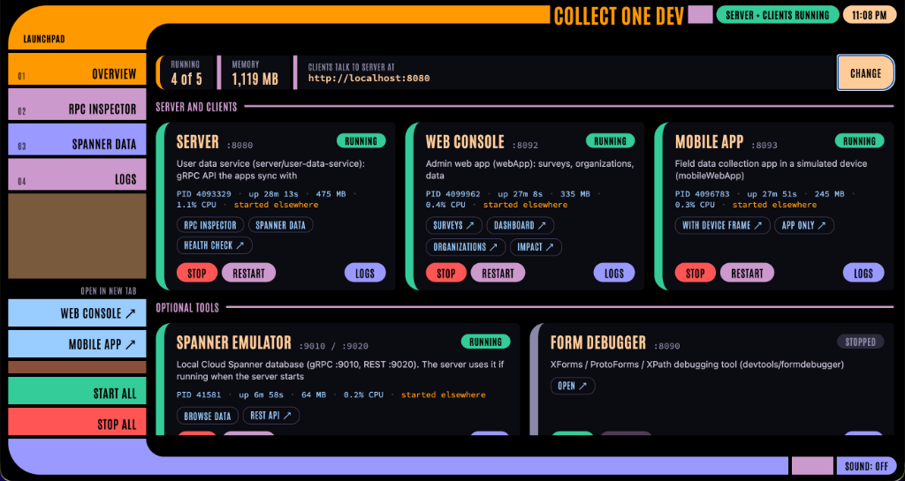

<!--
  Copyright 2026 The Ground Authors.

  Licensed under the Apache License, Version 2.0 (the "License");
  you may not use this file except in compliance with the License.
  You may obtain a copy of the License at

      https://www.apache.org/licenses/LICENSE-2.0

  Unless required by applicable law or agreed to in writing, software
  distributed under the License is distributed on an "AS IS" BASIS,
  WITHOUT WARRANTIES OR CONDITIONS OF ANY KIND, either express or implied.
  See the License for the specific language governing permissions and
  limitations under the License.
-->

# Collect One Dev Launchpad

A browser page for starting, stopping, and watching the Collect One server and
clients during local development, styled after the LCARS interface from Star
Trek: The Next Generation. It's a single Node.js script with no dependencies
beyond Node 22.



## Running It

From the repository root:

```bash
bash scripts/launchpad.sh              # http://localhost:8099
bash scripts/launchpad.sh --port 9000  # Another port (or PORT=9000)
bash scripts/launchpad.sh --start-all  # Also start the server and both clients
bash scripts/launchpad.sh --kill-existing --start-all  # Fresh start: stop what's running first
```

`--start-all` does what **Start all** does as soon as the launchpad is up:
it starts the server, web console, and mobile app, skipping any that are
already running. Their logs appear on the Logs page.

`--kill-existing` first stops a launchpad already using the launchpad port and
every service that's running, wherever it was started (another workspace, a
terminal, or an earlier launchpad), and waits for their ports to be released.
Combined with `--start-all`, the launchpad then starts the server and clients
itself, so their logs appear on the Logs page.

Then open `http://localhost:8099` (or your workstation's hostname or HTTPS
proxy URL; links to the other services follow whichever host you used).

## Services

| Service | Port | Directory | Started with |
| :--- | :--- | :--- | :--- |
| Server (user data service) | 8080 | `server/userDataService` | `./gradlew run` |
| Web console | 8092 | `webApp` | `./gradlew wasmJsBrowserDevelopmentRun` |
| Mobile app | 8093 | `mobileWebApp` | `./gradlew wasmJsBrowserDevelopmentRun` |
| Spanner emulator (optional) | 9010, 9020 | `.` | `scripts/spanner-emulator.sh` |

If the Spanner emulator is running when the server starts, the launchpad
starts the server with `SPANNER_EMULATOR_HOST=localhost:9010`.

## Pages

- **Overview**: A card per service. The coloured bracket on its left and the
  badge show its state (green running, gold starting, red crashed, grey
  stopped). Running cards show the process ID, uptime, memory, and CPU. Each
  card has links to the service's pages, a **Start** or **Stop** button,
  **Restart**, and **Logs**, which opens the Logs page filtered to that
  service.
- **RPC inspector** and **Spanner data**: The server's debug pages
  (`:8080/debug` and `:8080/debug/spanner`), shown inside the launchpad.
- **Logs**: All captured output, filterable by service and text.

The current page is kept in the URL (`#overview`, `#rpc`, `#spanner`,
`#logs`), so reloading or bookmarking returns to it.

The web console and mobile app always open in their own tabs,
from the links on their cards (marked ↗) or the **Web console ↗** and
**Mobile app ↗** buttons in the left column.

The page loads the Antonio font from Google Fonts and falls back to a local
condensed font when offline.

## Services Started Elsewhere

The launchpad finds services that are already running by checking their ports,
and marks them **started elsewhere**. It can stop them, but it can't show
their output. **Restart** stops one and starts it again from the launchpad,
after which its logs appear.

**Stop** stops the process the launchpad started and anything still listening
on the service's port (the Gradle dev servers leave a webpack process behind
otherwise), escalating from `SIGTERM` to `SIGKILL` after 2.5 seconds.

## Server URL

The web console and mobile app dev servers proxy gRPC-Web calls to
`USER_DATA_SERVICE_URL` from `local.properties`. The overview shows it
as **Clients talk to server at**; **Change** edits that line, and the change
takes effect on the next page reload.

## API

The page uses this HTTP API, which you can also call directly:

| Method and path | Does |
| :--- | :--- |
| `GET /api/status` | Status of every service, host info, and the server URL |
| `GET /api/events` | Server-Sent Events: `status` and `log` |
| `GET /api/logs?service=<id>&limit=<n>` | Captured log lines (default 500) |
| `POST /api/logs/<id or all>/clear` | Clears captured logs |
| `POST /api/service/<id>/start` | Starts a service |
| `POST /api/service/<id>/stop` | Stops a service |
| `POST /api/service/<id>/restart` | Restarts a service from the launchpad |
| `POST /api/fleet/start-core` | Starts the server, web console, and mobile app |
| `POST /api/fleet/stop-all` | Stops every service |
| `POST /api/config/sync-local-properties` | Sets `USER_DATA_SERVICE_URL`; body `{"url": "..."}` |

Service IDs: `user-data-service`, `web-console`, `mobile-app`,
`spanner-emulator`.
