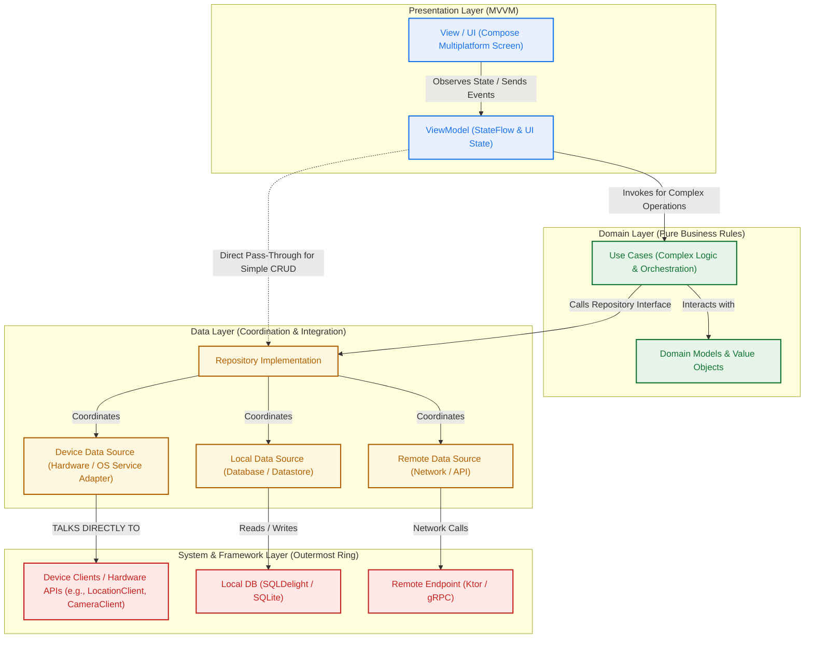
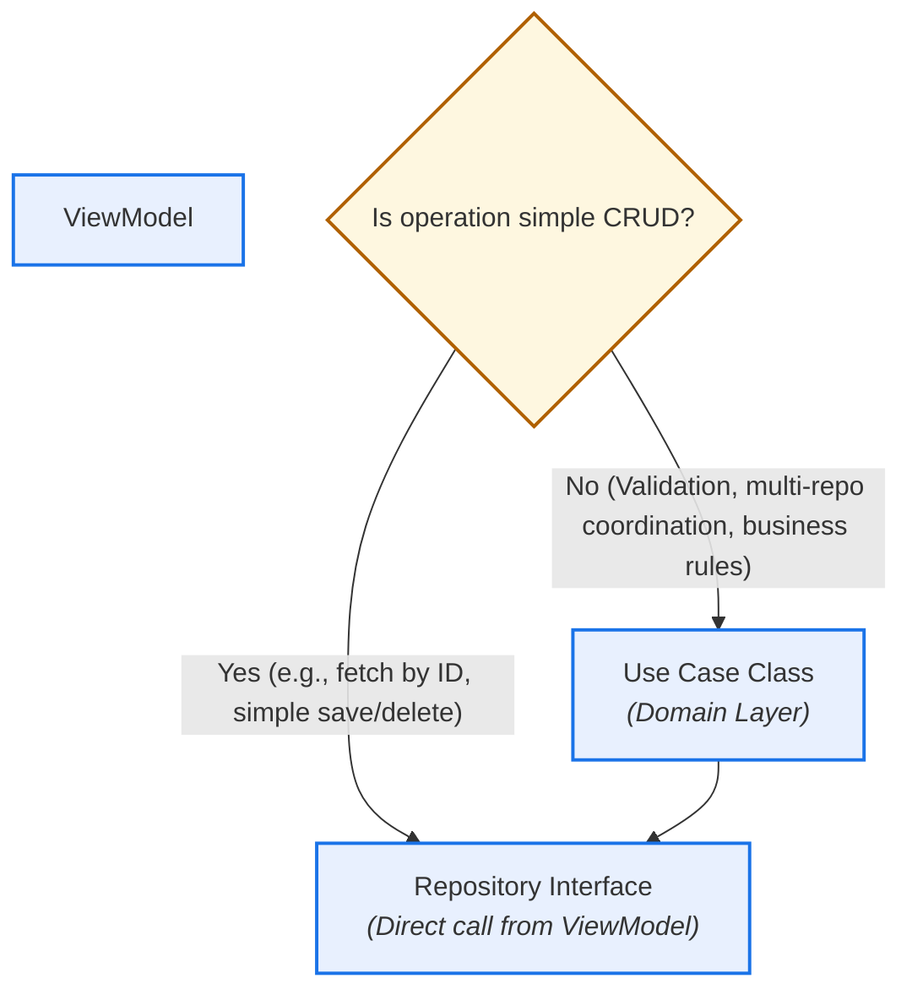
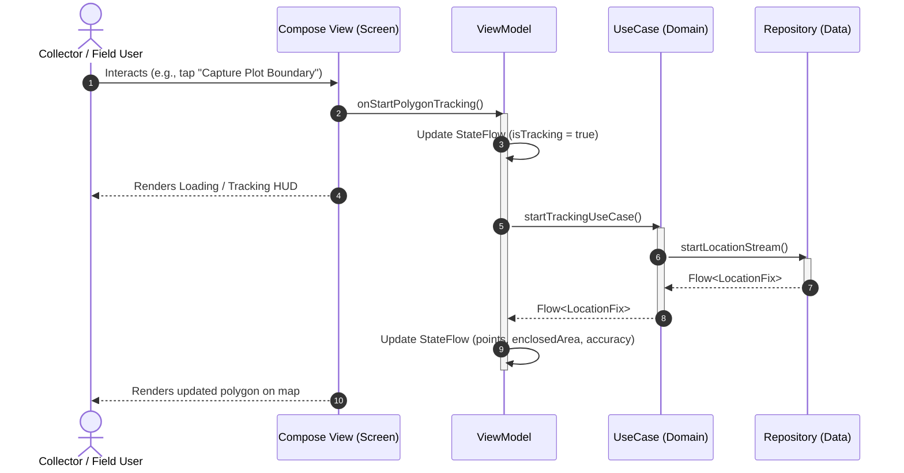
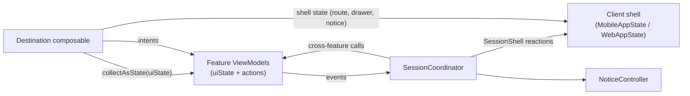
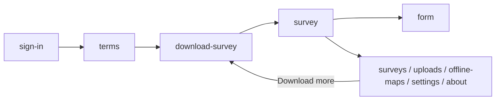
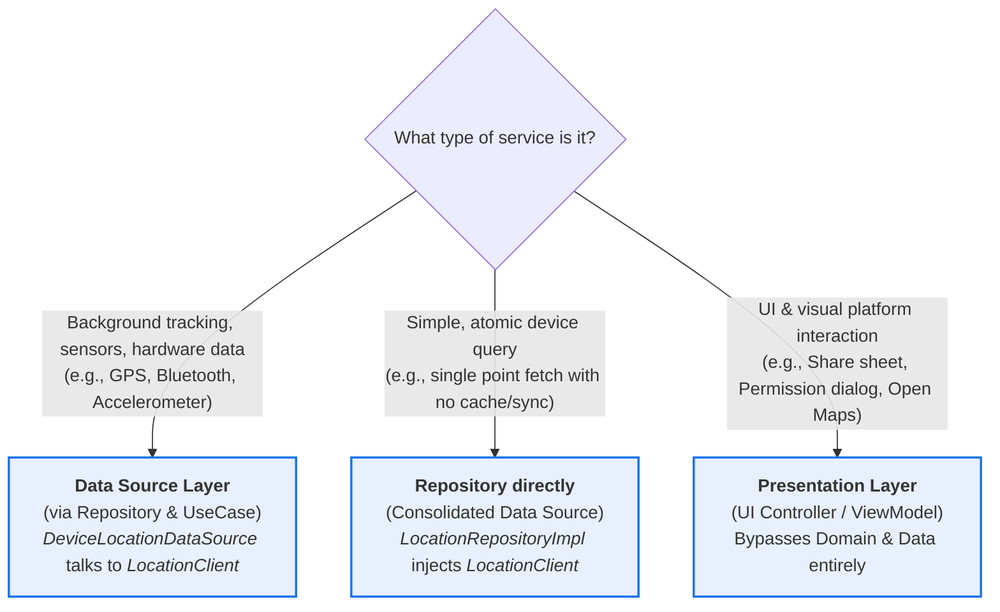

<!--
  Copyright 2026 The Collect One Authors.

  Licensed under the Apache License, Version 2.0 (the "License");
  you may not use this file except in compliance with the License.
  You may obtain a copy of the License at

      https://www.apache.org/licenses/LICENSE-2.0

  Unless required by applicable law or agreed to in writing, software
  distributed under the License is distributed on an "AS IS" BASIS,
  WITHOUT WARRANTIES OR CONDITIONS OF ANY KIND, either express or implied.
  See the License for the specific language governing permissions and
  limitations under the License.
-->

# Open Foris Collect One Architecture: Clean Architecture & MVVM in Kotlin Multiplatform

This document outlines how Open Foris Collect One implements **Clean Architecture** and **Model-View-ViewModel (MVVM)** across Kotlin Multiplatform (KMP) and Compose Multiplatform (CMP). It establishes explicit layering boundaries, dependency rules, naming standards, and answers who can communicate directly with repositories and system/hardware service clients.


## Core Principles & Motivation

Open Foris Collect One is an offline-first, cross-platform geospatial data collection, satellite visual interpretation, and monitoring platform targeting Android, iOS, and Web. Adopting Clean Architecture and MVVM provides critical engineering advantages:

1. **Strict Dependency Rule (Inward Dependencies)**: Dependencies point strictly inwards toward the core business domain. Inner layers know nothing about outer frameworks, databases, or UI toolkits.
2. **Platform Agnosticism**: Core business logic (form evaluation, validation, survey models, offline sync coordination) lives in pure Kotlin Multiplatform (`commonMain`) with zero platform-specific imports.
3. **Single Responsibility & Testability**: Business rules, state orchestration, data coordination, and hardware access are decoupled. Each layer is independently testable via unit tests without mocking UI or OS lifecycles.
4. **Predictable Unidirectional Data Flow (UDF)**: ViewModels expose immutable `StateFlow` streams observed by declarative Compose UI, while user interactions flow down as explicit events or intent methods.
5. **Pragmatic Complexity (CRUD vs. Business Logic)**: We avoid unnecessary boilerplate. Simple CRUD operations pass directly from ViewModels to Repositories. Dedicated Use Cases are introduced only when operations involve non-trivial business logic, multi-repository orchestration, validation, or complex data transformations.

### Relevant References & Specifications
- [The Clean Architecture (Robert C. Martin / Uncle Bob)](https://blog.cleancoder.com/uncle-bob/2012/08/13/the-clean-architecture.html)
- [Android Guide to App Architecture (Data Layer & Domain Layer)](https://developer.android.com/topic/architecture)
- [Android Architecture Recommendations: Domain Layer & Use Cases](https://developer.android.com/topic/architecture/domain-layer)
- [Android Architecture Recommendations: Data Layer](https://developer.android.com/topic/architecture/data-layer)
- [Open Foris Collect One Multiplatform Architecture (`shared/README.md`)](../../../shared/README.md)
- [Open Foris Collect One Shared Mobile Module (`shared/mobile/README.md`)](../../../shared/mobile/README.md)


## High-Level Architectural Layers

The architecture is divided into three concentric Clean Architecture tiers, with the **Presentation Layer** structured according to **MVVM**:



### Layer Responsibilities

| Layer | Clean Layer | Components | Role & Responsibilities |
| :--- | :--- | :--- | :--- |
| **Presentation** | UI / Framework | Compose UI (`Screen`, `Card`, `Widget`), `ViewModel`, `UiState` | Implements MVVM. Collects user events, maintains screen state via `StateFlow<UiState>`, and coordinates actions. Direct CRUD operations pass through to Repositories; complex actions invoke Use Cases. |
| **Domain** | Use Cases / Entities | Use Cases, Domain Models, Repository Interfaces | Pure Kotlin (`commonMain`). Contains business entities, business rules, and defines repository contracts. Houses Use Cases for non-trivial orchestration. Has **no** knowledge of SQL, JSON, network APIs, or Android/iOS SDKs. |
| **Data** | Interface Adapters | Repository Implementations, Data Sources | Coordinates where data comes from (local database, remote server, or hardware sensors). Maps transport/storage models to clean Domain Models. |
| **Framework** | Frameworks & Drivers | Platform SDKs, SQLite, Ktor, Device Clients | External operating system capabilities, hardware drivers, and raw communication channels. |


## The MVVM Pattern & Use Case Boundaries

The presentation tier adheres to strict **Model-View-ViewModel (MVVM)** with unidirectional data flow (UDF).

### The Rule for Use Cases vs. Direct Repository Access

To keep the architecture lean and avoid redundant boilerplate forwarding classes:

- **Simple CRUD Operations**: A ViewModel can call Repository interfaces directly for basic reads, writes, updates, and deletes (e.g., `surveyRepository.getSurvey(id)`, `draftRepository.deleteDraft(id)`, or observing `surveyRepository.surveyFlow`). Creating a Use Case that merely forwards a single method call to a repository adds no architectural value.
- **Complex Operations (Use Cases Required)**: Anything more complicated than simple CRUD **must** be encapsulated in a dedicated **Use Case** class in the Domain Layer. Examples include:
  - Combining or orchestrating multiple repositories (e.g., `SubmitSurveyResponseUseCase` coordinating validation, local entity mutations, and offline sync queueing).
  - Business rules, geometric computations, or algorithmic transformations (e.g., `ValidatePolygonBoundaryUseCase`, `ComputeWalkedAreaUseCase`).
  - Complex lifecycle or hardware stream coordination (e.g., `StartPolygonTrackingUseCase`).



### Unidirectional Data Flow Sequence



### MVVM Rules
1. **Views are Declarative and Passive**: Compose screens observe state via `collectAsStateWithLifecycle()` (or CMP equivalent) and dispatch user intents to ViewModel functions. Views contain no business decisions or algorithmic calculations.
2. **ViewModels Orchestrate Screen State**: ViewModels manage UI state and handle events. They delegate business rules to Use Cases and simple data storage/retrieval to Repositories. ViewModels never talk directly to Data Sources, Databases, or Device Clients.
3. **State Flows Down, Events Flow Up**: ViewModels expose immutable `StateFlow<ScreenUiState>` representations of screen state. Side effects (e.g., snackbars, navigation) use shared channels or single-event flows.

### Screens, ViewModels, and the Session Shell

Both clients share the same feature ViewModels (`AppViewModels`: onboarding, settings, survey map, dashboard, data collection, and the searchable list's search), and there is no session-wide state facade between them and the screens:



1. **Destinations read ViewModels.** A destination gets its ViewModels from Koin (`koinSessionViewModel()` on mobile, `sessionViewModel()` or `koinViewModel()` on the web), collects their `uiState`, and passes the screen its state and the ViewModels' focused action interfaces (`SurveyMapActions`, `DataCollectionActions`, `ListSearchActions`, ...). Screens never take a session object.
2. **Derived screen state is a pure function.** State that combines several ViewModels (the bottom sheet, the searchable list, the details cards: `SurveyRecordsUiStates`; the Main Survey's `MainSurveyUiState`; what the user may do in the active survey: `ActiveSurveyAccess`) is built by plain functions of the ViewModels' states. Composables call them with the states they collected (`collectSurveyRecordsUiStates(...)`); tests call them with `.value`s.
3. **Intents that span ViewModels get a small adapter.** `SessionSearchableListActions` and `SessionEntityDetailsActions` implement the list's and the details' action interfaces over the ViewModels (selecting a layer clears the selected map feature and place, toggling navigation finds the place first).
4. **`SessionCoordinator` routes events, and holds no state.** It applies each ViewModel's events to the others they concern (a map feature selected on the map selects its record in data collection and its row in the dashboard), shows their notices through the session's `NoticeController`, and tells the client's shell what to show through the `SessionShell` interface. Hosts close it when the session leaves composition, so a session rebuilt around the same ViewModels never handles an event twice.
5. **The shell holds only shell state.** `MobileAppState` keeps where the user is (its `MobileNavigator`), the Main Survey's map or list mode, the drawer and profile panel, the workbench's hooks, and the reactions to device connectivity, and implements `SessionShell` to navigate after cross-feature outcomes. `WebAppState` keeps the recently opened surveys, invitation links, and the store of the ViewModels several pages share. Neither mirrors ViewModel state or forwards their intents.
6. **Connectivity policy is a ViewModel parameter.** The web console ignores the device's connectivity: it builds its ViewModels with `isAlwaysOnline = true` (`koinAppViewModels(isAlwaysOnline = true)`), and passes `ignoreOffline = true` to the actions that take it.


## Errors

Operations that can fail for a reason the user should hear about (sign-in, directory lookups, invitations, imagery tile URLs, and other calls to the user data service) return a `DomainResult<T>` from their repository or use case instead of throwing:

- **`DomainError`** (`domain/error/`): a small sealed set of reasons: `Network`, `Unauthenticated`, `PermissionDenied`, `NotFound`, `Conflict`, `Validation`, `QuotaExceeded`, `Cancelled` (the user dismissed it), and `Unknown(cause)`. Add a case only when some caller handles it differently.
- **`DomainResult<T>`** (`domain/error/`): `Success(value)` or `Failure(error)`. It's used instead of `kotlin.Result`, whose failure is an untyped `Throwable` and whose `runCatching` also catches coroutine cancellation.
- **One mapping point** (`data/error/DomainErrorMapping.kt`): repositories wrap remote calls in `domainResultOf { … }`, which maps gRPC statuses and auth client error codes to `DomainError` and always rethrows `CancellationException`. Repositories, use cases, and ViewModels don't catch exceptions themselves.
- **One presentation mapper** (`ui/text/ErrorMessages.kt`): ViewModels turn a `DomainError` into localized `UiText` there, never into raw exception text.
- **Background sync errors are typed too**: an outbox entry records why its last send failed as a `DomainError` (`PendingMutation.lastError`, persisted as `last_error_kind`), and `SyncActivity.lastError`, `UserDataSyncState.Failed`, and `BackendOperationError` hold a `DomainError`, so the sync error banners show the same localized messages. The server's or exception's raw message is diagnostic detail only: it's logged, and outbox entries keep it in `lastErrorDetail` (shown in the mobile Uploads view's failure detail), but banners never show it.

## Logging

The client apps log with [Kermit](https://kermit.touchlab.co/) (`co.touchlab:kermit`), never with `println` or the browser console directly:

- **Tagged loggers**: each file that logs declares `private val log = Logger.withTag("SyncCoordinator")` (the class or area as the tag) and logs at a sensible severity: `d` for developer detail (a file saved in the temp directory), `i` for notable events, `w` for failures the app recovers from (a sync or send that will be retried, a map layer that couldn't be added), and `e` for broken setups (a missing JS bridge). Pass the exception (`log.w(e) { … }`) when its stack trace helps.
- **One configuration**: each host calls `configureAppLogging(isDevelopmentBuild)` (`app/logging/` in `shared/app/data`) at startup. Development builds log from `Debug` up, builds served to real users from `Info` up: the Android app follows the build's `debuggable` flag, the web console its `DEV_SIGN_IN` setting, and the mobile app in the browser (a testing host) always logs debug messages. Messages go to the platform's writer: Logcat on Android, the browser console on Wasm, standard output on the JVM.
- **No personal data or secrets**: `RedactingLogWriter` replaces email addresses, bearer tokens, and JWTs in every message (and in the stack trace of a logged exception). Still, don't put user data (answers, names, locations) in log messages; log identifiers and counts instead.
- **Enforced**: `ClientLoggingGuardrailTest` (`shared/app` `jvmTest`) fails on `println`, `print`, `System.out`/`System.err`, `printStackTrace()`, `console.*`, or `android.util.Log` in the production source sets of the client modules. The server logs with SLF4J.

## Dependency Injection with Koin

Both clients build their object graph with [Koin](https://insert-koin.io/). The modules are organized by layer and live in each module's `di/` package, the composition root:

| Module | Where | Contents | Scope |
| --- | --- | --- | --- |
| `platformModule(...)` | `shared/app/data` `di/` | Platform services: `AuthClient`, `PushSubscriptionClient`, `PdfExportClient`, `OfflineRegionClient` (saving map areas for offline use; simulated in the browser), `DeviceStorageClient`, the wall `Clock`, and optionally the device's local database (`SqlDriverFactory`). Each host passes its own (for example the auth client it restored the session with; the Android app and the mobile app in the browser pass their database) | App singletons |
| `dataModule(config)` | `shared/app/data` `di/` | App scope, `LocalStore` (a `PersistentLocalStore` when the platform module provides a database, else an `InMemoryLocalStore`), user data service client, sync engine, Repository implementations, `UserDataSyncController`, `BackendErrorMonitor` | App singletons |
| `domainModule` | `shared/app` `di/` | Use cases both clients use | Factories (use cases hold no state) |
| `mapModule`, `dataCollectionModule`, `dashboardModule`, `onboardingModule`, `settingsModule`, `listSearchModule` | Each feature module's `di/` (`shared/app/map`, `shared/app/datacollection`, `shared/app/dashboard`, ...) | The feature's ViewModel (`SurveyMapViewModel`, `DataCollectionViewModel`, `DashboardViewModel`, ...) | `viewModel { }` |
| `webDomainModule`, `webViewModelModule` | `shared/web` `di/` (each feature's ViewModel module in its own module's `di/`) | Web-only use cases and ViewModels | Factories, `viewModel { }` |
| `mobileViewModelModule` | `shared/mobile` `di/` | Mobile-only ViewModels (`MainSurveyViewModel`) | `viewModel { }` |

`AppConfig` tells `dataModule` which user data service to talk to and how to sync. Definitions that need a user data service exist only when the config has one, so their consumers resolve them with `getOrNull()`. `appModules(config, platform)`, `webModules(...)`, and `mobileModules(...)` assemble each client's graph.

Rules:

1. **Hosts start Koin.** `androidApp` (through `MobileSyncRuntime`, which the push service and sync worker share), `webApp`, and `mobileWebApp` start the global Koin application with their modules in their entry point. Shared code never starts or stops Koin.
2. **Classes take dependencies through their constructors.** Only Koin modules call `get()`. ViewModels, use cases, and repositories never look anything up themselves.
3. **Unit tests don't use Koin.** They construct the class under test directly with fakes. Each graph has one test that creates every definition (`AppModulesTest`, `WebModulesTest`, `MobileModulesTest`), so a missing binding fails in CI, not at runtime.
4. **`AppDataHolder` is a migration facade.** It wires nothing: it resolves its members from the Koin graph for the client shells (`MobileAppState`, `WebAppState`, `WorkbenchState`) and tests that still read their dependencies from one object. Don't add members to it. New code takes its dependencies through its constructor.

## Dates and Times

App code (everything outside the XForms engine in `shared/core`, which keeps its own XForms-compatible calendar code) uses `kotlin.time.Instant`, `kotlin.time.Duration`, and [kotlinx-datetime](https://github.com/Kotlin/kotlinx-datetime) (`LocalDate`, `LocalDateTime`, `TimeZone`):

- **One clock.** `platformModule` provides the graph's single `kotlin.time.Clock`. Use cases and ViewModels take a `Clock` in their constructor (ViewModels default to `Clock.System`), the sync engine likewise, and composables showing elapsed time read `LocalClock`. Nothing calls the system time directly, so tests set it with `FakeClock` (`shared/app/testing`).
- **Formatting through kotlinx-datetime formats.** ISO 8601 UTC text goes through `isoUtc` / `parseIsoUtc`, date picker values through `DatePickerConversions.kt`, and PDF report dates through `formatUtcTimestamp`; don't hand-roll calendar arithmetic.
- **Forms run on the device clock, in its time zone.** The XForms engine's `FormEnvironment.DEFAULT` clock is fixed (2026-09-17) for deterministic tests, so data collection and the Form editor preview open forms in `deviceFormEnvironment(clock)`: `today()`, the `date` and `time` preloads, and the time question's Now button give the device's local date and time of day, while timestamps (`now()`, `start`, `end`) stay UTC instants. Show Wire instants with `formatIsoInstant`, never `toString()`, which is ISO 8601 only on the JVM.
- **Epoch milliseconds only at boundaries** that define them: the Material 3 `DatePicker`, `shared/core` models (`MediaAttachment.capturedAtEpochMillis`, `ImpactFeature.updatedAtMillis`), and the time series points. Protobuf `Timestamp`s stay Wire instants in stored models and convert with `toKotlinInstant()` / `toWireInstant()`.

## Navigation

Both apps move between their screens with type-safe [Compose Multiplatform navigation](https://www.jetbrains.com/help/kotlin-multiplatform-dev/compose-navigation.html) (`org.jetbrains.androidx.navigation:navigation-compose`). Each app has its own routes and `NavHost`; they share no navigation code.

### Mobile App



| Piece | Where | Role |
| --- | --- | --- |
| `MobileRoute` | `shared/mobile` `ui/navigation/` | One `@Serializable` data object per destination. Routes carry no data; screens read it from their ViewModels and the local data store. The drawer pages are `MainSurveyPage`s. Serial names are the URL fragments on mobile web, so keep them short and stable |
| `MobileNavigator` | `shared/mobile` `ui/navigation/` | Moves between routes (`navigate`, `resetTo`, `popBackTo`, `back`). Once the `NavHost` attaches its `NavController`, the back stack lives there; before that (and in unit tests) the navigator keeps it itself |
| `MobileAppState` | `shared/mobile` `ui/` | The app shell: as the `SessionShell` of its `SessionCoordinator`, decides where to go after cross-feature events (signing in or out, opening a survey, opening the form) through its `navigator`, and reacts to route changes from anywhere (leaving the form route closes the form) |
| `MobileNavHost` | `shared/mobile` `ui/navigation/` | The one `NavHost`, with a destination per route and no transitions |

Rules:

1. **The data on the device picks the start route.** `MobileLaunchViewModel` waits for the session restored from the device's local database (offline too) and, past onboarding, for the user's stored data to be in the local store (`UserDataSyncController.hasLoadedLocalData`), never for the network; `MobileAppSession` then starts the navigator at `launchRoute`:
   1. Sign in while signed out, then the Terms of Service until the user accepts them.
   2. The Main Survey when the survey the user last opened is still on the device (see [Active Survey](local-data-store.md#active-survey)).
   3. Otherwise the surveys on the device (`DownloadedSurveys`, the drawer's Surveys page, which then has no Main Survey under it: no Back button, and Back is left to the system), when any survey is downloaded.
   4. Otherwise Download survey, which shows an offline banner while the device has no connection.

   The sync continues in the background and the screens update as data arrives. The launch is decided once per graph and `ViewModelStore`, so a session rebuilt after an Android configuration change starts the same way. Later sign-ins, terms acceptance, and sign-outs navigate from there.
2. **Navigation state is the back stack.** Don't add screen enums or "is open" flags for screens; add a route. Onboarding steps start over at their route (`resetTo`); drawer pages and the form open over the Main Survey. State that isn't a route (the Main Survey's map or list view) stays in a ViewModel's `SavedStateHandle`.
3. **Destinations get their ViewModels from Koin.** A destination calls `koinSessionViewModel()` for the ViewModels it shares with the session (they live in the host's `ViewModelStore`, which outlives the one navigation graph) and takes only shell state and actions (the notice, the drawer, navigation) from `MobileAppState`. A ViewModel only one destination uses should be scoped to its back stack entry with plain `koinViewModel()`.
4. **Each destination owns its Back behavior.** The `NavHost` pops the back stack on the system Back gesture. A destination where Back does more (declining the terms, the sign-out prompt on Download survey, closing the drawer or a selection on the Main Survey, closing the form) installs a `NavigationBackHandler` that runs the matching action. At the bottom of the back stack, Back is left to the system.
5. **Process death and reloads restore the route.** On Android, the `NavController` saves the back stack with the rest of the UI state and the rebuilt session adopts it. The mobile app in the browser without the workbench chrome binds the back stack to the window history (`bindToBrowserNavigation`): Back and Forward move through routes, the URL fragment names the current route (`#survey`, `#settings`), and a reload restores it while the user is still signed in with the terms accepted (`resumesAtHistoryRoute`). A restored route that shows a survey (the Main Survey, its pages, and its form) comes back only while a survey is open (`MobileLaunch.mayRestore`), and otherwise the app starts at its start route (rule 1) instead of showing another survey. Inside the workbench's simulated device the history stays unbound. A form can't outlive the process, so a restored `form` route without an open form returns to the Main Survey.
6. **Tests.** Unit tests construct `MobileAppState` directly, drive its `viewModels`, and assert `currentRoute`, `navigator.backStack`, or the ViewModels' `uiState`. `MobileLaunchRouteTest` and `MobileLaunchViewModelTest` cover the start route rules. Compose UI tests (`MobileBackStackTest`, `MobileRouteRestorationTest`, `MobileActiveSurveyRestorationTest`) compose the app through `MobileAppSession` over a Koin graph with the mobile modules, send system Back gestures through a `NavigationEventDispatcher`, and restore saved UI state to emulate process death.

### Web Console

The web console's navigation is bound to the browser's history. See
[web-console.md](web-console.md#navigation-and-urls) for its URLs.

1. **A page is a route.** Each page is a `@Serializable` `WebRoute` (`shared/web` `navigation/`) and a destination of the `NavHost` in `WebConsoleNavHost.kt`. Route arguments are identifiers and URL segments (a survey ID, a tab), never data; the destination reads the data from its ViewModels.
2. **The URL is the route.** `WebUrls` maps every route to a path and back (`/surveys/<id>/dashboard`), and `BrowserHistoryBinding` stores the back stack with each browser history entry, so links, Back and Forward, and reloading all open the same page.
3. **Pages don't see the navigation library.** Destinations (`WebConsoleDestinations.kt`) ask the `WebPageNavigation` interface for page changes, and stateless pages report intents through callbacks. ViewModels stay unaware of navigation: their outcomes are events that `webNavigationRequests` turns into page changes.
4. **The route drives what a page shows.** A destination applies its route to its ViewModels when it opens (it makes the route's survey active, opens its organization, starts the wizard), and reports in-page changes (tab, step, editor section, Impact focus) back with `WebPageNavigation.update`, which replaces the history entry instead of adding one.
5. **Access is decided per page.** `WebRouteGuard` is a pure function of the route and what the signed-in user can open; destinations wait for the initial sync before treating missing data as missing.
6. **Destinations get their own ViewModels.** Each destination calls `koinViewModel()`. A ViewModel that several pages share (organizations, the Survey editor and the wizard that edits through it, Impact, Time series) comes from `sessionViewModel()`, which keeps it in the session's `ViewModelStoreOwner` (the browser window), so every page sees the same instance and navigation never clears it. A ViewModel only one page uses (the surveys page's outcome prompt) lives in that page's back-stack entry. `WebAppState` holds only the session's own state (recent surveys, invitation links) and the shared feature ViewModels it hands to destinations.

## ViewModel Lifecycle

ViewModels extend the multiplatform `androidx.lifecycle.ViewModel` (JetBrains' `org.jetbrains.androidx.lifecycle` artifacts) and run their work in `viewModelScope`:

- **Dispatcher seam.** Each ViewModel takes a `dispatcher` (default `ViewModelDispatcher`, an immediate dispatcher, so a store write reaches `uiState` before the action that started it returns). Tests pass a test dispatcher; they never pass a scope.
- **Ownership.** Hosts get the ViewModels with `koinViewModel()` (`koinAppViewModels()`, the web console's `sessionViewModel()`), so they live in the host's `ViewModelStore` (the Android activity, or the browser window), survive configuration changes, and are cleared with it. Code outside composition (tests, the workbench) gets them with `AppViewModels.create(dataHolder)`.
- **Sessions are rebuilt; ViewModels are not.** `MobileAppSession` and `WebAppSession` build the client shell around the ViewModels and close it when it leaves composition. The shell's `SessionCoordinator` routes the ViewModels' events in its own scope, which closing cancels, so a session rebuilt after a configuration change never handles an event twice.
- **Child ViewModels.** A ViewModel owned by another ViewModel (the Survey editor's Form editors) runs in a child of its owner's `viewModelScope` and stops with it; no extra `Job` bookkeeping.

### SavedStateHandle Rules

Android can kill the app's process in the background and later restore its screens. The mobile app's navigation back stack (which screen, drawer page, or form is open) is restored by its `NavHost` (see [Navigation](#navigation)). ViewModels keep the rest of the **small set of UI state the user would otherwise lose** in the `SavedStateHandle` that `koinViewModel()` provides:

| State | Owner | Key |
| --- | --- | --- |
| Main Survey map or list | `MainSurveyViewModel` | `mainViewMode` |
| Survey search query | `OnboardingViewModel` | `searchQuery` |
| Searchable list query | `DashboardViewModel` | `listSearchQuery` |
| Selected map feature and submission | `DataCollectionViewModel` | `selectedEntityId`, `selectedSubmissionId` |

1. **Save identifiers and short strings, never data.** Surveys, records, and drafts come back from the local data store, which also keeps the active survey; don't copy them into saved state.
2. **Read once, write on change.** A ViewModel reads its saved values when it builds its initial state and mirrors later changes with `saveInto(...)`. Save enums by name and ignore unknown names, so an app update can't crash on restored state.
3. **Default to an empty handle.** Constructors take `savedState: SavedStateHandle = SavedStateHandle()`, so tests and non-Android hosts need nothing extra.

## Communication with Device Services & Hardware APIs

A central architectural question in mobile engineering is: **Who can talk directly to device services and hardware wrappers (e.g., Location, Sensors, Camera, Bluetooth)?**

### Standard Rule: Only a Data Source Talks to Device Service Wrappers

In Clean Architecture, a device service wrapper represents an external framework dependency on the outermost ring. Therefore:
> **The only component that should talk directly to a device service client (e.g., `LocationClient`, `GnssHardwareClient`) is a specialized Data Source in the Data Layer.**

```mermaid
flowchart LR
    UC["Domain Layer<br/><b>LocationTrackingUseCase</b>"]
    REPO["Data Layer<br/><b>LocationRepositoryImpl</b>"]
    DS["Data Source Layer<br/><b>DeviceLocationDataSource</b>"]
    CLIENT["System Framework Wrapper<br/><b>LocationClient</b>"]
    OS["OS Native API<br/><i>(Android FusedLocation / iOS CoreLocation)</i>"]

    UC -->|"1. Invokes repository contract"| REPO
    REPO -->|"2. Coordinates source"| DS
    DS -->|"3. TALKS DIRECTLY TO"| CLIENT
    CLIENT -->|"4. Native calls"| OS

    classDef clean fill:#E6F4EA,stroke:#137333,stroke-width:2px;
    classDef warn fill:#FEF7E0,stroke:#B06000,stroke-width:2px;
    classDef danger fill:#FCE8E6,stroke:#C5221F,stroke-width:2px;

    class UC clean;
    class REPO,DS warn;
    class CLIENT,OS danger;
```



### Why We Standardize on Data Sources (and Avoid "Providers")

1. **Avoid "Provider" Ambiguity**: We intentionally avoid the term `Provider` (e.g., `LocationProvider`) because it is overloaded with design pattern baggage (the Provider pattern, ContentProvider, dependency injection provider factories). We prefer concrete, descriptive names:
   - System/Hardware Wrapper: `LocationClient`, `GnssClient`, `CameraClient`.
   - Data Source Adapter: `DeviceLocationDataSource`, `GnssLocationDataSource`.
2. **Data Mapping & Boundary Isolation**: System services return platform-specific data types (e.g., `android.location.Location` on Android or `CLLocation` on iOS). The presentation and domain layers must never import or observe these types. The **Data Source** acts as the isolation boundary, transforming platform objects into clean Kotlin domain value objects (e.g., `LocationFix(latitude, longitude, altitude, accuracy)`).
3. **Seamless Platform Swapping (KMP)**: In Kotlin Multiplatform, `LocationClient` defines a pure common interface in `commonMain`, while `androidMain` and `iosMain` provide native implementations using Android FusedLocationProvider and Apple CoreLocation respectively. Swapping platform implementations or providing test fakes requires touching only the framework/data source layer, leaving domain and presentation untouched.


## Architectural Variations & Scope Boundaries

While the **Data Source** is the canonical Clean Architecture pattern for device and hardware services, two other patterns are recognized depending on service scope:



### Data Source (Default for Data-Producing Services)
- **Scope**: Continuous streams, sensor polling, hardware data feeds (GNSS location, compass heading, camera frame capture, battery status).
- **Communication Path**: `UseCase` → `Repository` → `DataSource` → `DeviceClient`.
- **Reason**: Requires data mapping, buffering, or coordination with databases/sync queues.

### Consolidated Repository (For Trivial / Atomic Operations)
- **Scope**: Trivial device queries where introducing a separate Data Source class would be redundant boilerplate (e.g., single one-off battery level check or simple screen orientation query).
- **Communication Path**: `UseCase` → `RepositoryImpl` → `DeviceClient`.
- **Constraint**: The `RepositoryImpl` directly performs the conversion from platform-specific types to domain models.

### Presentation / UI Infrastructure (For Foreground UI Utilities)
- **Scope**: Visual platform interactions that do not produce domain data—such as opening the system share sheet, launching an external navigation intent (Google Maps), triggering native haptic feedback, or displaying OS runtime permission prompts.
- **Communication Path**: `View` / `ViewModel` → `UiPlatformLauncher` / `HapticFeedbackClient`.
- **Reason**: These are presentation/framework concerns that have no domain business logic and do not pass through the data layer.


## Directory Structure & Module Placement

Within Open Foris Collect One, clean layering is mapped across KMP modules. Each module
keeps the same layer names (`domain/`, `data/`, `client/`, `di/`, `ui/`) for the
code it owns; code lives in the lowest module that every user of it depends
on, so each app's build includes only what it uses. `shared/app` is itself
split by layer into `:shared:app:domain`, `:shared:app:data`, and the
presentation, which is split again by feature (`:shared:app:resources`,
`:shared:app:ui-common`, the feature modules `:shared:app:map`,
`:shared:app:datacollection`, `:shared:app:dashboard`, `:shared:app:onboarding`,
`:shared:app:settings`, and `:shared:app:listsearch`, and `:shared:app` on top), so the compiler keeps its layers and features apart; see [modules.md](modules.md) for the
module graph and why the boundaries are where they are.

```text
├── shared/
│   ├── protos/           # Canonical Protocol Buffer schemas (ProtoForms, SurveyDef, DataRecords)
│   ├── core/             # Pure KMP runtime: XForms/XPath evaluator, reactive FormEngine, sampling, impact
│   ├── ui/               # Shared CMP theme (AppTheme), question cards, form wizard
│   ├── map/              # Shared map rendering (Mapbox)
│   │   └── geometry/     # :shared:map:geometry: LatLng, LngLatBounds, Geometry (no Compose)
│   ├── app/              # Code both clients use (org.openforis.collectone.v2.app), by module:
│   │   ├── domain/       # :shared:app:domain (pure Kotlin)
│   │   │   └── domain/   # Use cases, domain models, repository contracts
│   │   │       ├── model/
│   │   │       ├── repository/
│   │   │       └── usecase/  # Non-trivial orchestration and business logic
│   │   ├── data/         # :shared:app:data
│   │   │   ├── data/     # Repositories, data sources, the local store, sample data
│   │   │   │   ├── datasource/
│   │   │   │   │   ├── local/
│   │   │   │   │   ├── remote/
│   │   │   │   │   └── device/   ← DeviceLocationDataSource talks to LocationClient
│   │   │   │   ├── repository/
│   │   │   │   └── seed/
│   │   │   ├── client/   # System/hardware client interfaces (expect/actual implementations)
│   │   │   └── di/       # Koin modules of the data layer (platformModule, dataModule)
│   │   ├── resources/    # :shared:app:resources: the UI strings (9 locales) and their Res
│   │   ├── ui-common/    # :shared:app:ui-common: ui/text, ui/common, ui/navigation, ui/viewmodel
│   │   ├── map/          # :shared:app:map: ui/map (survey map ViewModel, state, views), di/mapModule
│   │   ├── datacollection/  # :shared:app:datacollection: ui/datacollection, client/pdf,
│   │   │                 #   di/dataCollectionModule
│   │   ├── dashboard/    # :shared:app:dashboard: ui/dashboard, di/dashboardModule
│   │   ├── onboarding/   # :shared:app:onboarding: ui/onboarding, di/onboardingModule
│   │   ├── settings/     # :shared:app:settings: ui/settings, di/settingsModule
│   │   ├── listsearch/   # :shared:app:listsearch: ui/listsearch, di/listSearchModule
│   │   ├── testing/      # :shared:app:testing: data-level test fixtures
│   │   ├── ui-testing/   # :shared:app:ui-testing: app-level test fixtures (the assembled session)
│   │   ├── di/           # :shared:app: the rest of the composition root (domainModule,
│   │   │                 #   appModules, AppDataHolder)
│   │   └── ui/           # :shared:app: the session shell (ui/session) and AppViewModels
│   ├── mobile/           # The mobile app: MobileAppState, routes and NavHost, screens,
│   │                     #   MobileApp(), and its Koin modules (di/MobileModules)
│   └── web/              # :shared:web, the web console shell: WebAppState, WebConsoleApp(),
│       │                 #   its routes and NavHost (navigation/), the dashboard and header, and
│       │                 #   its Koin modules (di/WebModule)
│       ├── domain/       # :shared:web:domain: web-only domain models and use cases (pure Kotlin)
│       ├── resources/    # :shared:web:resources: the console's strings (9 locales) and their Res
│       ├── ui-common/    # :shared:web:ui-common: ui/common, ui/text, ui/surveyoutcome
│       ├── formeditor/   # Feature modules, each with its ViewModel, UI state, views, and Koin
│       ├── surveyeditor/ #   module (see modules.md): the Form and Survey editors, the wizard,
│       ├── wizard/       #   the surveys list, the organization pages, the Impact page, and the
│       ├── surveys/      #   Time series panel
│       ├── organization/
│       ├── impact/
│       ├── timeseries/
│       └── testing/      # :shared:web:testing: the web modules' test fixtures
├── androidApp/           # Thin Android entry point, platform initialization, native permissions
├── iosApp/               # Thin iOS entry point, Xcode app wrapper (links AppMobile.xcframework)
├── webApp/               # Wasm host of the web console (WebConsoleApp)
├── mobileWebApp/         # Wasm host of the mobile app in the browser, for testing
│   └── workbench/        # Simulated device, XForms editor, and sample data tools around it
└── devtools/
    └── launchpad/        # Local dev launchpad for the server, web console, mobile app, and Spanner emulator
```

Dependencies point from the hosts inwards: `webApp` → `shared/web` → `shared/app`;
`androidApp`, `iosApp`, and `mobileWebApp` (with `workbench`) → `shared/mobile` →
`shared/app`; and `shared/app` → its feature modules (`datacollection` → `map`) →
`ui-common` → `shared/app/data` → `shared/app/domain` → `shared/core`,
`shared/map/geometry`, with the presentation modules also on `shared/ui`, the
strings (`resources`), and (`map`) `shared/map`. The web
console and the mobile app never import each other, and only `shared/app`'s own
`data/` and `di/` import `data.*`. The module graph enforces most of these rules
at compile time (`ModuleGraphTest` keeps it as designed); each module's
`LayerDependencyArchitectureTest` checks the rest with
[Konsist](https://docs.konsist.lemonappdev.com/), with no allowlists.

The domain holds no display text: it describes what to show as semantic enums and
`DomainMessage` keys (with format arguments), and the presentation mappers in
`shared/app/ui-common`'s `ui/text/` (`DomainMessageText.kt`, `DomainLabels.kt`,
`EditorLabels.kt`) turn them into localized `UiText` and string resources. Navigation and screen models live in
`ui/navigation/`. Two tests in `shared/app` keep it that way:
`DomainTextGuardrailTest` fails when a domain type exposes a `String` named like
display text (`label`, `message`, `description`, `reason`, `summary`, `noun`) outside its
shrink-only allowlist of user data, and `LocaleKeyParityTest` fails when a string
key is missing from any of the 9 locales. Raw failure text
(`Throwable.diagnosticMessage()`, `MutationLogItem.stateDetail`) is for
diagnostics only; users see a `DomainError` through `ErrorMessages`.

When a domain result needs words around user data, the domain returns a typed value and the UI
words it: typed coordinates in the place search are a `SurveyPlaceItem` of `PlaceKind.COORDINATES`
(named by `ui/text/PlaceText.kt`), and a question's validation is a list of `ValidationCondition`s
(described by the Form editor's `validationSummaryText`). Stored survey content follows the same
rule: the survey author's own nouns stay data (`MapLayerItem.singularNoun`/`pluralNoun`,
`GeospatialEntityItem.typeNoun`), blank when the author gave none, and the UI falls back to a generic
noun in the user's language (`ui/text/FeatureTypeText.kt`); what the app itself decides is a typed
value, such as `OfflineImageryType`, `SurveyAreaSource`, or a submission without an entity (a standalone
field log). ViewModels build notices as `UiText`
(for example `SurveyMapEvent.NavigationStarted`), and `NoticeController.show(UiText)` resolves them
in the user's language; a later notice or clear wins over one still being resolved. Form content is
not editor text: the default `jr:constraintMsg` exported with a form (`ValidationRules.message`)
stays in English, the forms' default language.

Text made at the user's request outside composition is loaded when it's made, so it's in the
language selected at that moment: PDF reports (`RecordPdfReports`, `ImpactPdfReports`) load their
text (`PdfReportStrings.load()`) when they're generated, and their ViewModels generate them in a
coroutine. Lists of names sort as they're shown. Language pickers (mobile Settings and Sign in, web
header) show each language by its native name and list them in `LanguageOption.NATIVE_NAME_ORDER`:
by that name, lower-cased, in Unicode order, the same in every language and on every platform
(Latin-script names alphabetically, then Thai, Lao, and Khmer). The country picker lists countries
by their name in the current language with the platform's collation for it
(`countriesInDisplayOrder`: `java.text.Collator` on the JVM, `Intl.Collator` in the browser);
English keeps the order of `Countries.all`.


## Summary Checklist for Code Reviews

When authoring or reviewing Kotlin code in Open Foris Collect One, verify against this checklist:

- [ ] **Dependency Direction**: Do imports point inwards toward domain? No domain class imports classes from `data`, `ui`, `android.*`, or `platform.*`.
- [ ] **Pure Domain Models**: Does the domain layer use pure Kotlin data classes? Platform-specific objects (`android.location.Location`, `CLLocation`) must never cross into domain or presentation.
- [ ] **CRUD vs. Use Cases**: Are simple CRUD operations calling Repositories directly from ViewModels? Is anything with business logic, multi-repo orchestration, or validation placed in a dedicated Use Case?
- [ ] **No Direct Service Access from UI**: Do ViewModels or Views refrain from calling device clients directly? All data-producing hardware services are accessed via Data Sources.
- [ ] **Semantic Naming**: Are hardware wrappers named `Client` (e.g., `LocationClient`) rather than `Provider`? Are business classes named `UseCase` rather than `Interactor`?
- [ ] **Unidirectional Data Flow**: Do ViewModels expose immutable `StateFlow` and handle user events via functions?
- [ ] **Testing**: Can the UseCase and ViewModel be unit-tested using Kotlin test fakes without mocking Android/iOS framework classes?
- [ ] **Dependency Injection**: Does the class take its dependencies through its constructor, with its Koin definition in the module of its layer? Does a new definition keep the module graph tests passing?
- [ ] **Typed Errors**: Do operations that can fail for user-visible reasons return a `DomainResult`, with failures mapped in `data/error/` and shown through `ErrorMessages`, and no broad `catch (e: Exception)`?
- [ ] **Logging**: Does the code log through a tagged Kermit logger at a sensible severity, without user data, instead of `println` or the console?
- [ ] **Saved State**: Does UI state that must survive Android process death live in a `SavedStateHandle` (identifiers and short strings only)?
