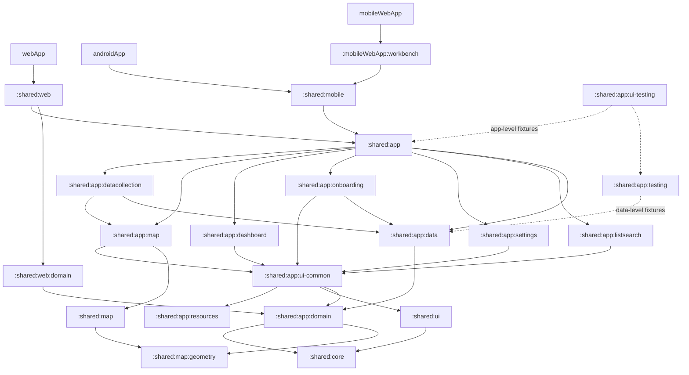
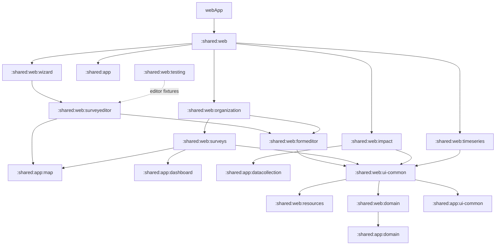

<!--
  Copyright 2026 The Collect One Authors.

  Licensed under the Apache License, Version 2.0 (the "License");
  you may not use this file except in compliance with the License.
  You may obtain a copy of the License at

      https://www.apache.org/licenses/LICENSE-2.0

  Unless required by applicable law or agreed to in writing, software
  distributed under the License is distributed on an "AS IS" BASIS,
  WITHOUT WARRANTIES OR CONDITIONS OF ANY KIND, either express or implied.
  See the License for the specific language governing permissions and
  limitations under the License.
-->

# Client Modules

**TL;DR:** `shared/app` is split into Gradle modules along the layers of
[architecture.md](architecture.md), so the compiler, not only Konsist, keeps
them apart: `:shared:app:domain` (pure Kotlin) ← `:shared:app:data` (stores,
sync, remote, device clients, and the data-layer Koin graph) ← the
presentation. The presentation is split again by feature:
`:shared:app:resources` (the strings) and `:shared:app:ui-common` (shared
presentation code) at the bottom, the feature modules on them
(`:shared:app:map`, `:shared:app:datacollection`, `:shared:app:dashboard`,
`:shared:app:onboarding`, `:shared:app:settings`, and
`:shared:app:listsearch`), and `:shared:app` (the session shell and the
composition root) on top. The web
console (`shared/web`) is split the same way: one resources module, a shared
presentation module, and a module per feature under the console shell (see
[Web Console Modules](#web-console-modules)).

## Module Graph

Every solid edge is an `api` dependency: each module re-exports what it builds
on, so the modules above `:shared:app` keep compiling against the same classes.
`:shared:app:ui-common` doesn't build on `:shared:app:data`: the profile
pictures it shows load through the domain's `ProfileImageLoader`, which the
data layer implements and the app session provides (`LocalProfileImageLoader`).

## Modules

| Module | Packages (`org.openforis.collectone.v2.app.…`) | Builds on | Compose |
| :--- | :--- | :--- | :--- |
| `:shared:app:domain` | `domain.*`: models, repository interfaces, use cases, `DomainError`, `DomainMessage`, the editor models and XForms generation | `:shared:core`, `:shared:map:geometry` (geometry types, no Compose) | No |
| `:shared:app:data` | `data.*` (repository implementations, local store and SQLDelight database, sync engine, gRPC remote, mappers, seeds), `client.*` (device and platform clients), `logging` (the client logger's setup, `configureAppLogging`), and the data-layer graph in `di` (`AppConfig`, `platformModule`, `dataModule`, `UserDataSyncController`, `BackendErrorMonitor`); the SQLDelight database and its browser worker (`web/sqlite-worker/`) | `:shared:app:domain` | No |
| `:shared:app:resources` | The UI strings of all 9 locales (`src/commonMain/composeResources`) and their generated `Res` accessors (`resources`); no Kotlin code | — | Resources only |
| `:shared:app:ui-common` | `ui.text` (domain text mappers, `UiText`), `ui.common` (shared composables and foreground platform bridges, with the media capture JS bridge), `ui.navigation` (navigation models and labels), `ui.viewmodel` (ViewModel helpers: saved state, scopes) | `:shared:app:domain`, `:shared:app:resources`, `:shared:ui` | Yes |
| `:shared:app:map` | `ui.map`: `SurveyMapViewModel` (with its internal state parts: `SurveyMapSession`, `SurveyMapData`, `SurveyMapUiStateBuilder`, `SurveyMapWayfinding`, `OverlayTileUrlRefresher`), `SurveyMapUiState`, the map views and content builders, `WayfindingBadges`; `di.mapModule` | `:shared:app:ui-common`, `:shared:map` | Yes |
| `:shared:app:datacollection` | `ui.datacollection`: `DataCollectionViewModel` (with its action interfaces, the pure state builders in `DataCollectionUiStateBuilder.kt`, and the PDF exports it delegates to, `DataCollectionPdfExports`), `DataCollectionUiState`, `FormWizardLaunch.kt`, `WebMapDrawingHost`, the GeoID QR code encoder (`QrCodeMatrix.kt`), the form, record details, and searchable list views, the survey maps that show the open form; `client.pdf`: the record PDF report layout (`RecordPdfReports`, `PdfReportLayout`, `PdfReportStrings`) and the PDF writer (`PdfDocumentWriter`, `PdfPage`, `PdfFont`, `WinAnsi`); `di.dataCollectionModule` | `:shared:app:map`, `:shared:app:ui-common`, `:shared:app:data` (the `PdfExportClient` the ViewModel delivers reports to) | Yes |
| `:shared:app:dashboard` | `ui.dashboard`: `DashboardViewModel` (with its layout session state in `DashboardSession` and dataset exports in `DashboardExports`), `DashboardUiState`; `di.dashboardModule` | `:shared:app:ui-common` | Yes (no views) |
| `:shared:app:onboarding` | `ui.onboarding`: `OnboardingViewModel` (with debounced remote lookup in `SurveyDirectorySearch` and pure filtering in `OnboardingSurveyFilter.kt`), `OnboardingUiState`; `di.onboardingModule` | `:shared:app:ui-common`, `:shared:app:data` (the initial sync state its Koin module reads) | Yes (no views) |
| `:shared:app:settings` | `ui.settings`: `SettingsViewModel`, `SettingsUiState`, `LanguageSelection.kt`; `di.settingsModule` | `:shared:app:ui-common` | Yes (no views) |
| `:shared:app:listsearch` | `ui.listsearch`: `ListSearchViewModel`, `ListSearchUiState`; `di.listSearchModule` | `:shared:app:ui-common` | Yes (no views) |
| `:shared:app` | The session shell (`ui.session`: `SessionCoordinator`, `SurveyRecordsUiStates`, the backend and sync banners, the developer sign-in dialog), `ui.AppViewModels`, and the rest of `di` (`domainModule`, `appModules`, and the `AppDataHolder` facade, which creates ViewModels) | all of the above | Yes |
| `:shared:web:domain` | `org.openforis.collectone.v2.web.domain.*`: the web console's own editor models, importers, and use cases | `:shared:app:domain` | No |
| `:shared:app:testing` | Data-level test fixtures (sample stores, seeded user data service, sample data, editor samples, fakes) | `:shared:app:data`, `:shared:ui:testing` | — |
| `:shared:app:ui-testing` | App-level test fixtures (`sampleDataHolder`, `TestAppSession`, ViewModel builders and fakes, the Koin graph assertions) | `:shared:app`, `:shared:app:testing` | — |

Packages keep their names across modules: `di` and `client.pdf` are split
between modules, so imports don't change when code moves down a module.

### Why these boundaries

-   **They follow the existing dependency direction.** `domain` imports nothing
    else in `shared/app`; `data` and `client` import only `domain` (and each
    other); `ui` and `di` import everything below them. The cut lines are where
    the code already had no back edges, so the split moves files without
    rewriting them.
-   **The compiler enforces the layer rules that matter most.** `domain` can't
    see `data`, `client`, `ui`, Compose, or the `Res` strings: they aren't on
    its classpath. `data` can't see ViewModels, UI state, or strings. A feature
    module can't see `:shared:app`, the session shell, or the features above
    it. A dependency that points the wrong way is a cycle, which Gradle
    rejects.
-   **Each feature owns its ViewModel, UI state, and views.** The package of a
    feature (`ui.map`, `ui.datacollection`, `ui.dashboard`, ...) holds its
    `*ViewModel` (with its `*Actions`), its `*UiState` and `*Event`s, and its
    views; there is no shared `ui.state` package. `ui.viewmodel` only holds the
    helpers every ViewModel uses.
-   **Data collection builds on the map, not the other way round.** The data
    collection state uses the map's drawing types (`DraftGeometry`,
    `FormGeometryOverlay`), and its form screen embeds map views. The map views
    that show the open form (`SurveyMainMap`'s form overlay variant,
    `GeoPointFormMap`, `EntityRefFormMap`, and the matching `SurveyMapContent`
    builders, as extensions) live in `ui.datacollection`.
-   **The session shell stays on top.** `SurveyRecordsUiStates` combines the
    dashboard, data collection, map, and list search states with the session's
    access and notice, so it lives in `ui.session`, in `:shared:app`.
-   **`client` goes with `data`.** Data sources are the only callers of device
    clients (see "Communication with Device Services" in
    [architecture.md](architecture.md)), and the data-layer Koin graph builds
    them. The PDF report layout formats localized text and theme colors, so it
    is presentation and moves with its only user, the data collection
    feature. The platform delivery client (`PdfExportClient`) stays in `data`.
-   **Koin modules per Gradle module.** `:shared:app:data` owns
    `platformModule(...)` and `dataModule(config)`; each feature module owns
    the module that builds its ViewModel (`mapModule`, `dataCollectionModule`,
    `dashboardModule`, `onboardingModule`, `settingsModule`,
    `listSearchModule`); `:shared:app` owns `domainModule` and
    `appModules(...)`, which assembles them all and creates the
    `AppDataHolder` facade.
-   **One resources module.** Compose resources are generated per module, so
    the strings (all 9 locales) live in `:shared:app:resources`, which every
    presentation module depends on. It generates the same public `Res` class in
    the same package (`org.openforis.collectone.v2.app.resources`) as before,
    so no import changed, and the web bundles package the strings under the
    same path. The other presentation modules generate no `Res` of their own
    (`generateResClass = never`).
-   **The geometry types are pure Kotlin.** `LatLng`, `LngLatBounds`, and
    `Geometry` live in `:shared:map:geometry`, which has only Compose's
    stability annotations, so the domain doesn't get Compose through
    `:shared:map`. `:shared:map` re-exports them in the same package.
-   **`:shared:core` stays the form engine.** It is not renamed or merged.

### Tests

Tests move with the code they test. Two fixture modules keep the domain and
data tests away from the presentation: `:shared:app:testing` (data-level
fixtures, on `:shared:app:data`) for every module's tests, and
`:shared:app:ui-testing` (the assembled app session, on `:shared:app`) for the
presentation modules and the clients. A feature module's test that needs the
assembled session (most ViewModel tests, which build on `sampleDataHolder` or
`TestAppSession`) either stays in `:shared:app` or depends on
`:shared:app:ui-testing` from `commonTest` (`:shared:app:datacollection` does,
for `RecordPdfReportsTest`, which checks internal API, and
`:shared:app:listsearch` for `ListSearchViewModelTest`). The dashboard,
onboarding, and settings ViewModel tests build their ViewModels from a seeded
store and the repository implementations, so their modules depend only on
`:shared:app:testing`. Tests that span layers
stay in `:shared:app`: the Koin graph checks, the architecture and module
graph tests, the sample data guardrail, the `AppDataHolder` sync tests, and the
domain tests that check how domain values are presented
(`StaticColorTokensTest`, `EditorIssueTextParityTest`,
`LaunchFormUseCaseTest`).

## Web Console Modules

`shared/web` follows the same pattern. The console shell (`:shared:web`)
keeps the navigation, the session state (`WebAppState`), the dashboard, the
header, and the composition of the pages; each feature with its own page has
its own module.

| Module | Packages (`org.openforis.collectone.v2.web.…`) | Builds on |
| :--- | :--- | :--- |
| `:shared:web:domain` | `domain.*`: the web console's own editor models, importers, and use cases (no Compose) | `:shared:app:domain` |
| `:shared:web:resources` | The web console's strings in all 9 locales and their generated `Res` accessors (`resources`); no Kotlin code | — |
| `:shared:web:ui-common` | `ui.common` (shared composables and browser bridges), `ui.text` (text mappers of the web domain, including `ImpactText.resolve`), `ui.surveyoutcome` (the survey outcome card) | `:shared:web:domain`, `:shared:web:resources`, `:shared:app:ui-common` |
| `:shared:web:formeditor` | `ui.formeditor`: `FormEditorViewModel`, `FormEditorUiState`, the Form editor's views (the Survey editor and the organization's Templates tab create it, so no Koin module) | `:shared:web:ui-common` |
| `:shared:web:surveyeditor` | `ui.surveyeditor`: `SurveyEditorViewModel`, `SurveyEditorUiState`, the Survey editor's views; `di.surveyEditorModule` | `:shared:web:formeditor`, `:shared:app:map` |
| `:shared:web:wizard` | `ui.wizard`: `CreateSurveyWizardViewModel`, `CreateSurveyWizardUiState`, the wizard page and steps; `di.wizardModule` | `:shared:web:surveyeditor` |
| `:shared:web:surveys` | `ui.surveys`: the Surveys page, survey cards, the create survey dialog, `SurveyOutcomePromptViewModel`; `di.surveysModule` | `:shared:web:ui-common`, `:shared:app:dashboard` (the dashboard state), `:shared:app:map` (the survey map thumbnail) |
| `:shared:web:organization` | `ui.organization`: `OrganizationViewModel`, `OrganizationUiState`, the Organizations and Organization pages (library templates open in the shared Form editor); `di.organizationModule` | `:shared:web:surveys`, `:shared:web:formeditor` |
| `:shared:web:impact` | `ui.impact`: `ImpactViewModel`, `ImpactUiState`, the Impact page; `client.pdf`: `ImpactPdfReports`; `di.impactModule` | `:shared:web:ui-common`, `:shared:app:data`, `:shared:app:datacollection` (the PDF report layout) |
| `:shared:web:timeseries` | `ui.timeseries`: `TimeSeriesViewModel`, `TimeSeriesUiState`, the Time series panel; `client.timeseries`: `PlotImageryRepository` (the plot analyses from the server); `di.timeSeriesModule` | `:shared:web:ui-common`, `:shared:app:data` |
| `:shared:web` | The console shell: `WebConsoleApp`, the navigation (`navigation`), `WebAppState` and the session ViewModels, `ui.dashboard`, `ui.header`, `ui.onboarding`, `ui.datacollection`, `ui.map`, and `di` (`webModules`, `webViewModelModule`, which includes each feature's Koin module) | all of the above, `:shared:app` |
| `:shared:web:testing` | Test fixtures: Survey and Form editor ViewModel builders and fakes, `SurveyLifecycleFixture` | `:shared:web:surveyeditor`, `:shared:app:testing` |

-   **One resources module.** As in `shared/app`, `:shared:web:resources`
    generates the one public `Res` class
    (`org.openforis.collectone.v2.web.resources`); every other web module
    sets `generateResClass = never`.
-   **Koin modules per feature.** Each feature module owns the Koin module that
    builds its ViewModel, in the `di` package; the shell's
    `webViewModelModule` includes them.
-   **Feature tests use the shared fixtures.** The Form editor's, the Survey
    editor's, and the surveys list's tests depend on `:shared:web:testing` from
    `commonTest` only; it builds on the Survey editor, so this test-only edge
    points up the graph without making a cycle. No production source set
    depends on a fixture module (`ModuleGraphTest` checks it).
-   **Visibility.** Declarations another module uses (a page the shell shows,
    a Survey editor pane the wizard reuses) are `public`; everything else
    stays `internal`.

## Enforcement

-   **The compiler** rejects imports across the graph: `domain` can't import
    `data`, `client`, `di`, `ui`, or `Res`; `data` can't import `ui` or `Res`;
    a feature module can't import `:shared:app` or a feature above it.
-   **Gradle** rejects dependencies that point back up, as they are cycles.
-   **`ModuleGraphTest`** (in `:shared:app`'s `jvmTest`) pins what each module
    builds on: `:shared:app:domain` only on `:shared:core` and
    `:shared:map:geometry`, `:shared:app:data` only on `:shared:app:domain`
    (neither applies Compose), `:shared:app:resources` on nothing,
    `:shared:app:ui-common` on the domain, strings, and `:shared:ui` (not data),
    `:shared:app:map` on `:shared:app:ui-common` and `:shared:map`,
    `:shared:app:datacollection` on the map feature, `:shared:app:ui-common`,
    and data, `:shared:app:dashboard`, `:shared:app:settings`, and
    `:shared:app:listsearch` on `:shared:app:ui-common` only,
    `:shared:app:onboarding` on `:shared:app:ui-common` and data, and
    `:shared:app:testing` on data only. `shared/web`'s
    `ModuleGraphTest` pins the web modules the same way: `:shared:web:domain`
    only on `:shared:app:domain` (without Compose), `:shared:web:resources` on
    nothing, `:shared:web:ui-common` on the domain and strings but not data,
    each feature module on the modules below it, and no module but the hosts
    on the shell (`:shared:web`). Both read the dependencies by source set and
    fail when a production source set (not `*Test`) depends on a test fixture
    module (`:shared:app:testing`, `:shared:app:ui-testing`,
    `:shared:web:testing`).
-   **`LayerDependencyArchitectureTest`** (Konsist) checks the rules that remain
    inside a module: no Compose imports in `domain` or `data`, no `di` in
    `data/`, only `di/` imports `data/` in the presentation modules, views
    reach neither `data/` nor `client/`, and the XML serializer boundaries.
    `shared/web`'s `LayerDependencyArchitectureTest` checks every web module:
    no `app.data` imports, a pure `domain/`, views that reach neither clients
    nor importers, and each ViewModel and UI state in its feature's package
    (`ui.<feature>`, no shared `ui.viewmodel` or `ui.state`).

## Rules for New Code

-   Put code in the lowest module every user of it depends on (see
    [GEMINI.md](../../../GEMINI.md)). A new repository interface or use case
    goes in `:shared:app:domain`; its implementation in `:shared:app:data`; its
    ViewModel in its feature's package, in the feature's module (a new
    feature gets its own module, like `:shared:app:settings`).
-   Put a feature's ViewModel, UI state, and views in one package
    (`ui.<feature>`), and register its ViewModel in its module's Koin module.
-   New strings go in `:shared:app:resources`, in every locale file.
-   Don't add Compose, Koin's Compose bindings, or `Res` to `domain` or `data`.
-   A class used by another module is `public`; keep everything else
    `internal`.

## Next Steps

-   **Feature tests in their modules.** Most map and data collection ViewModel
    tests stay in `:shared:app` because they build the whole session; moving
    them means a session fixture that doesn't need `:shared:app` (for example
    one built from the feature's own Koin module).
-   **The rest of the web console shell.** The dashboard (`ui.dashboard`, with
    the web data collection and map pieces it alone uses) and the header,
    onboarding, and invite pieces stay in `:shared:web` with the navigation;
    the dashboard could become a module once its page stops reaching into the
    session state (`WebAppState`).
-   **Web feature tests that need the console.** The wizard's ViewModel and
    page tests, the survey pages' tests, and a few Form and Survey editor
    tests open their pages in the whole console (`WebAppState`, navigation),
    so they stay in `:shared:web`.
