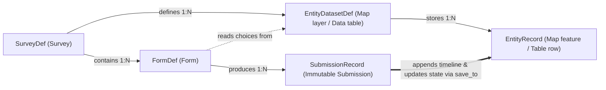
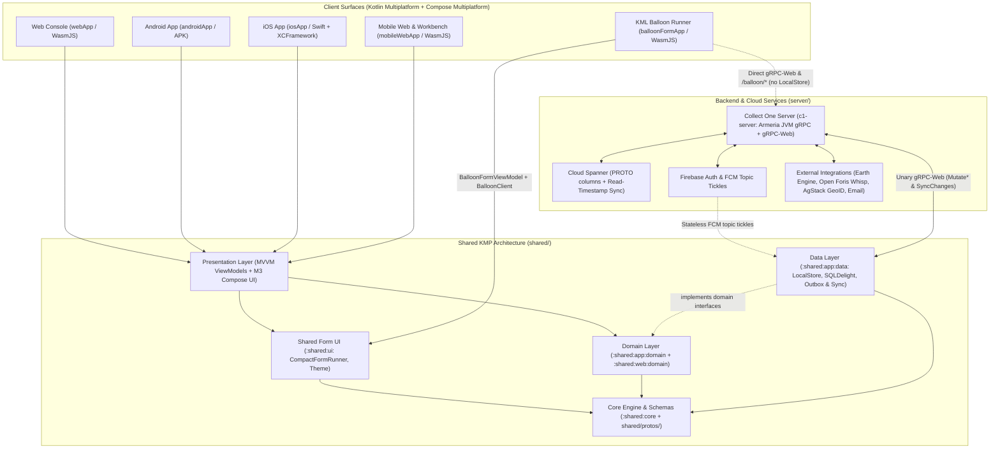
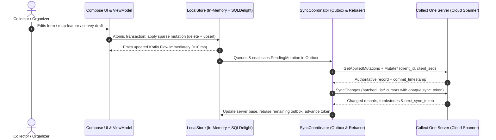

<!--
  Copyright 2026 The Collect One Authors.

  Licensed under the Apache License, Version 2.0 (the "License");
  you may not use this file except in compliance with the License.
  You may obtain a copy of the License at

      https://www.apache.org/licenses/LICENSE-2.0

  Unless required by applicable law or agreed to in writing, software
  distributed under the License is distributed on an "AS IS" BASIS,
  WITHOUT WARRANTIES OR CONDITIONS OF ANY KIND, either express or implied.
  See the License for the specific language governing permissions and
  limitations under the License.
-->

# Engineering Onboarding Guide

**TL;DR**: **Open Foris Collect One** ("Collect One") is an open-source, map-first survey, satellite visual interpretation, and offline field data collection platform built with **Kotlin Multiplatform**, **Compose Multiplatform**, **Protocol Buffers (ProtoForms / ODK XForms)**, **gRPC-Web**, and **Cloud Spanner**. Developed as open source by volunteers at Google to be maintained by the **Food and Agriculture Organization of the United Nations (FAO)** under the Open Foris initiative, Collect One unifies the capabilities of **Open Foris Ground** and **Collect Earth Online (CEO)** into a single codebase spanning Web, Android, iOS, Google Earth KML balloons, and a stateless cloud backend.

## Goals and Platform Context

### Why Collect One Exists

Environmental monitoring, forest inventories, restoration tracking, and deforestation-free supply-chain verification rely on two complementary workflows: **interpreting landscapes from satellite imagery at a desk** and **verifying plots on the ground in the field**.

Historically, Open Foris users and partner institutions ran these workflows across separate tools with separate data models:

- **Open Foris Ground** (hosted and operated by UN FAO) proved low-ceremony, map-first, offline mobile field data collection for smallholder farmers, community rangers, and researchers, but relied on a flat task list without hierarchical XForms logic, lacked iOS support, and maintained separate web and mobile codebases.
- **Collect Earth Online (CEO)** established browser-based statistical sample design, multi-temporal satellite visual interpretation, and multi-interpreter QA/QC, while desktop **Collect Earth** depended on Google Earth Pro (scheduled for sunset in June 2027).

Collect One brings both halves together into one open-source platform targeting functional parity with **Open Foris Ground** and **Collect Earth Online** (while providing a cloud- and mobile-native migration path for desktop **Collect Earth** campaigns) around three core engineering goals:

- **Adopt open standards end to end**: Represent questionnaires natively using the **ODK XForms / XLSForm** and **ODK Entities** data model (`ProtoForms`) so forms round-trip cleanly with ODK, KoboToolbox, Survey123, and **Open Foris Arena**.
- **Unify the technology stack**: Share domain models, form evaluation, validation, offline sync, and Material Design 3 UI across Web, Android, and iOS in **Kotlin Multiplatform (KMP)** and **Compose Multiplatform (CMP)**, eliminating cross-platform drift.
- **Deliver institutional trust and scale**: Enforce access control, multi-tenant **Organizations**, and resource quotas on an authoritative **Cloud Spanner** backend with immutable revision histories, audit logs, offline farmer PDF receipts, **Open Foris Whisp** and **AgStack GeoID** integrations, and built-in **MAP (Mitigation, Adaptation, and Protection)** live metrics.

### Guiding Product Principles

Every UX and architectural choice in Collect One follows three principles (detailed in the [PRD](../product/prd.md) and [Content Guidelines](../ux/content-guidelines.md)):

- **Proportional Complexity**: Creating a basic point-drop or boundary-walk survey takes a few clicks with sensible defaults; advanced capabilities (nested repeats, cascading choice filters, probabilistic sample designs, multi-wave updates) appear progressively only when needed.
- **Offline-First Resilience**: Field data collectors only need connectivity to download a survey and eventually sync results. Map rendering, GPS perimeter walks, XPath skip/validation logic, entity table lookups, and PDF receipt generation execute 100% offline.
- **Real-World Usability**: Interfaces avoid GIS jargon for survey organizers, prioritize high-contrast legibility and forgiving interactions for first-time smartphone users, and ship localized across 9 languages (`en`, `es`, `fr`, `km`, `lo`, `pt`, `sw`, `th`, `vi`).

## Core Functionality and Mental Model

### Application Surfaces

| Surface | Host Module | Primary Users | Core Capabilities |
| :--- | :--- | :--- | :--- |
| **Web Console** | [`webApp/`](../../webApp/) (`:shared:web`) | Survey organizers, organization managers, desk interpreters, QA/QC supervisors | Survey Creation Wizard, visual WYSIWYG Form Designer with live Mobile/Web previews, probabilistic sample plot generation, Earth Engine imagery & spectral time-series analysis, virtualized data tables & map, Organization libraries (dictionary concepts, templates, Purpose Packs), CSV/GeoJSON/KML/PDF exports, and Live Metrics |
| **Mobile App** | [`androidApp/`](../../androidApp/), [`iosApp/`](../../iosApp/), [`mobileWebApp/`](../../mobileWebApp/) (`:shared:mobile`) | Field data collectors, community rangers, extension agents | Explicit survey download, offline Mapbox satellite & terrain area caching, GPS boundary walking & pin capture, compass wayfinding HUD, single-question-per-screen XForms runner, offline PDF receipt generation, and background outbox synchronization |
| **Google Earth Balloons** | [`balloonFormApp/`](../../balloonFormApp/) | Desk interpreters working in Google Earth Web | Lightweight standalone Kotlin/Wasm form runner embedded inside self-refreshing NetworkLink KML placemark balloons (`Open in Google Earth`) with PKCE browser-tab authentication |
| **Mobile Workbench** | [`mobileWebApp/workbench/`](../../mobileWebApp/workbench/) | Developers, UX reviewers, form authors | Browser-hosted mobile app inside a simulated device frame (`?chrome=0` for full-window mode) with connectivity toggles, simulated GPS tracks, and XForms inspection tools |

### Terminology Bridge

If you are coming from Ground 1.0, Collect Earth Online, or Open Foris Arena, use this mapping (full lexicon in [Terminology](../product/terminology.md)):

| Collect One Term | Proto Message | Ground 1.0 Equivalent | CEO / XLSForm Equivalent | Role in Collect One |
| :--- | :--- | :--- | :--- | :--- |
| **Organization** | `Organization` | *(None)* | Institution | Multi-tenant container owning members (`MANAGER`, `MEMBER`), imagery sources, and shared libraries |
| **Survey** | `SurveyDef` | Survey | Project | Top-level campaign container holding forms, map layers, data tables, sharing policies, and ACLs |
| **Map layer** / **Data table** | `EntityDatasetDef` | Job site layer | Plot set / ODK Entity List | Schema for stateful spatial features (`GEOSPATIAL`) or non-spatial reference rows (`TABULAR`) |
| **Map feature** / **Table row** | `EntityRecord` | Location of Interest (LOI) | Sample plot / ODK Entity | Persistent real-world object (point, line, polygon, or plot with sub-plots) rendered on the map |
| **Form** | `FormDef` | Job (tasks list) | Survey questionnaire / XForm | Questionnaire defining questions, groups, repeats, XPath logic, and entity `save_to` bindings |
| **Question / Group / Repeat** | `ControlDef` | Task | Question / Group / Repeat | Nodes in the hierarchical form tree |
| **Submission** | `SubmissionRecord` | Submission | Plot interpretation / Submission | Immutable timestamped event record linked `N:1` to an `EntityRecord` timeline |

### Entity-First Data Model (`Sites on the Map, Submissions in the Timeline`)

Collect One cleanly separates **Current State** (`EntityDatasetDef` / `EntityRecord`) from **Immutable Transactions** (`FormDef` / `SubmissionRecord`):



- **Entity-only map**: The map renders **Map features** (`GEOSPATIAL` `EntityRecord`s) exclusively—never raw submission geometries—so longitudinal revisits and multi-interpreter checks never duplicate pins on the map.
- **Automatic `1 Form → 1 Map Layer` provisioning**: When an organizer creates a spatial form in the Survey Designer, Collect One automatically provisions a backing `EntityDatasetDef` (`action = CREATE`) and keeps top-level question `save_to` bindings synchronized with dataset properties.
- **Desk-to-field plot review loop**: Sample plots generated in the wizard or Survey Editor live in a geospatial `EntityDatasetDef`. Desk interpreters classify plots on imagery in the Web Console or Google Earth (`✓` desk verified), and low-confidence or ambiguous plots are automatically or manually flagged (`!`) for **field data collectors** to verify offline on mobile.

## End-to-End System Architecture



### Repository Layout

| Path | Purpose |
| :--- | :--- |
| [`shared/protos/`](../../shared/protos/) | Protocol Buffer (`proto3`) contracts for forms, surveys, ACLs, organizations, operational data, libraries, Earth Engine expressions, and sync RPCs |
| [`shared/core/`](../../shared/core/) | Pure KMP runtime (`commonMain` → JVM 17, iOS, JS, WasmJS): XForms XML/TextProto/JSON codecs, XPath 1.0 compiler & evaluator, reactive `FormEngine`, sparse proto mutations, sampling engine, and KML generation |
| [`shared/ui/`](../../shared/ui/) | Material Design 3 `AppTheme` (`Google Sans Flex` & `Google Sans Code`) and shared XForms UI runners (`MobileFormRunner`, `CompactFormRunner`) |
| [`shared/map/`](../../shared/map/) | Mapbox map rendering (`:shared:map`) and Compose-free spatial primitives (`:shared:map:geometry`: `LatLng`, `LngLatBounds`, `Geometry`) |
| [`shared/app/`](../../shared/app/) | Shared client application split by Clean Architecture layer (`domain`, `data`, `resources`, `ui-common`) and feature (`map`, `datacollection`, `dashboard`, `onboarding`, `settings`, `listsearch`) |
| [`shared/web/`](../../shared/web/) | Web Console shell (`:shared:web`), web domain (`:shared:web:domain`), and page feature modules (`wizard`, `surveyeditor`, `formeditor`, `surveys`, `organization`, `impact`, `timeseries`) |
| [`shared/mobile/`](../../shared/mobile/) | Mobile navigation, offline maps management, settings, and `MobileApp()` root shared across Android, iOS, and Mobile Web |
| [`server/`](../../server/) | Single-binary Kotlin/JVM backend (`c1-server`), Cloud Spanner store, Earth Engine & Whisp clients, transactional invite emails, FCM publisher, and `/debug` web inspectors |
| [`webApp/`](../../webApp/), [`mobileWebApp/`](../../mobileWebApp/), [`balloonFormApp/`](../../balloonFormApp/) | Thin Kotlin/Wasm browser hosts for the Web Console, Mobile Web (+ `workbench/`), and Google Earth KML balloons |
| [`androidApp/`](../../androidApp/), [`iosApp/`](../../iosApp/) | Thin native mobile wrappers hosting `MobileApp()` (iOS builds are opt-in via `-Pcollectone.ios=true`) |
| [`devtools/launchpad/`](../../devtools/launchpad/) | Zero-dependency Node.js local orchestration dashboard (`scripts/launchpad.sh`) |
| [`e2eTests/`](../../e2eTests/) | Playwright headless Chromium golden-screenshot integration suite running production Wasm bundles against `c1-server` and the Spanner emulator |
| [`build-logic/`](../../build-logic/) | Gradle convention plugins (`collectone.*`) centralizing KMP targets, Wire descriptors, `detekt`, `Kover`, and Wasm bundling |

## Shared Client Architecture (Kotlin Multiplatform)

Collect One enforces **Clean Architecture** and **Model-View-ViewModel (MVVM)** through physical Gradle module boundaries as well as **Konsist** architecture tests (`ModuleGraphTest`). Full details live in [Client Architecture](client/architecture.md) and [Client Modules](client/modules.md).

### Layering Rules

- **Strict inward dependencies**: `Presentation` → `Domain` ← `Data` ← `Platform / Framework`. `:shared:app:domain` is pure Kotlin with no Compose, SQLDelight, network, or OS SDK dependencies on its classpath.
- **Pragmatic MVVM**:
  - **Passive Compose Views** collect immutable `StateFlow<*UiState>` streams from feature ViewModels (obtained via **Koin**) and send user actions upward through focused `*Actions` interfaces.
  - **ViewModels** call **Repository interfaces** directly for simple CRUD reads/writes, and invoke dedicated **Use Cases** whenever an operation coordinates multiple repositories, validates domain rules, or performs geometric/form computations.
  - **`SessionCoordinator`** routes cross-feature events (for example, selecting a map feature updates data collection and dashboard panels) without holding duplicated state.
  - **Lightweight KML Balloon MVVM**: `balloonFormApp/` follows the same MVVM split (`BalloonFormViewModel` exposing `StateFlow<BalloonFormUiState>` + `BalloonFormActions` over a `BalloonClient` boundary) while depending only on `:shared:ui` and `:shared:core` so the sandboxed iframe bundle excludes SQLDelight, Mapbox, and Koin.
- **Typed Error Handling (`DomainResult<T>`)**: Fallible repository and use case calls return `DomainResult.Success` or `DomainResult.Failure(DomainError)` rather than throwing untyped exceptions. `DomainErrorMapping` translates gRPC/auth failures in one place, and `ErrorMessages` maps `DomainError` to localized `UiText`.
- **Cross-Cutting Hygiene**:
  - **Dependency Injection**: Assembled per host via Koin (`platformModule`, `dataModule`, `domainModule`, and per-feature `*Module`s); unit tests instantiate classes directly with fakes from `:shared:app:testing` and `:shared:app:ui-testing`.
  - **Time & Logging**: Time flows through an injectable `kotlin.time.Clock` (`kotlinx-datetime`), and client logging goes exclusively through **Kermit** (`RedactingLogWriter` scrubs emails and tokens; `println` and `console.*` fail `ClientLoggingGuardrailTest`).

### ProtoForms and `:shared:core`

`:shared:core` is the heart of Collect One's standards compatibility and runs on **both** every client and `:server`:

- **ProtoForms (`openforis.collectone.v1.forms`)**: A lossless `proto3` encoding of ODK XForms and ODK Entities. Forms authored in XLSForm or imported from XForms XML deserialize into `FormDef`, evaluate against `RecordInstance`, and serialize back to XML without losing unrecognized attributes or namespaces.
- **Boundary rule**: If another XForms tool (ODK Collect, Enketo, Open Foris Arena) would understand a construct, it belongs in `shared/protos/forms/`; Collect One-specific concepts (map styling, ACLs, quotas, sync tokens) stay in `shared/protos/survey/` or `shared/protos/data/`.
- **Reactive 5-stage `FormEngine`**: Compiles XPath 1.0 expressions once per `FormSession` (`CompiledForm`) and re-evaluates calculations, relevance (`relevant`), cascading `itemset`s, validation `constraint`s, and dynamic repeats in milliseconds on every answer edit.

## Offline-First Local Store and Sync Engine

Clients never render directly from network responses. Instead, [`LocalStore`](client/local-data-store.md) is the single source of truth, backed by [`SyncCoordinator`](sync-engine.md):



Key mechanics to understand when working on data or sync code:

- **Mobile vs. Web persistence**: Both clients read reactive `Flow`s from `InMemoryLocalStore`. Mobile hosts (`androidApp`, `iosApp`, `mobileWebApp`) wrap it in `PersistentLocalStore` (SQLDelight/SQLite), persisting downloaded surveys, server bases, pending outbox mutations, sync tokens, offline map regions, and the signed-in account across app restarts and airplane mode. The Web Console is online-only and keeps its store in memory for the active screen.
- **Sparse idempotent mutations & rebasing**: Edits are recorded as sparse domain protos (`delete` mask applied first, then `upsert` merged) using patch functions in `:shared:core` shared identically by client and server. `LocalStore` keeps the last server-confirmed **base** plus pending outbox mutations; when remote deltas arrive, `Rebaser` swaps in the newer base and replays unconfirmed local patches on top.
- **Batched delta pulls & stateless FCM tickles**: `SyncService.SyncChanges` batches all synced scopes (`ListSurveyOverviews`, `ListEntities`, `ListSubmissions`, `ListOrganizations`, `ListLibraries`, `ListImpactEvents`) into a single unary gRPC-Web round trip using opaque `sync_token`s. On mobile, devices subscribe directly to two Firebase Cloud Messaging topics per downloaded survey (`survey_<id>_def` and `survey_<id>_entities`) so the server stays 100% stateless—holding neither open streams nor device push token tables—while waking devices for targeted delta pulls when definitions or map features change.

## Backend Architecture (`server/` and Cloud Spanner)

The backend ([`server/README.md`](../../server/README.md)) is a single self-contained Kotlin/JVM application (`c1-server`) that compiles and runs on JDK 21 without requiring an Android SDK (`-Pcollectone.serverOnly=true`).

- **Transport (`app/`)**: **Armeria** serves native HTTP/2 gRPC, browser `gRPC-Web`, KML NetworkLink endpoints, PKCE balloon auth routes, `/health`, and developer debug UIs on a single `$PORT` (default `8080`). `WireGrpcBindings` bridges Wire-generated `@WireRpc` interfaces directly to `grpc-java` without extra codegen.
- **RPC Services (`service/`)**: `UserDataBackend` composes `SurveyServiceImpl`, `OrganizationServiceImpl`, `LibraryServiceImpl`, `DataServiceImpl` (with `PlotLocks` and `DataReports`), `GeoDataServiceImpl`, `ListBackedSyncService`, and `ClientVersionServiceImpl`. Server-owned fields (`audit_info`, `saved_revision_number`, `record_version`) and role/quota checks are enforced inside atomic transactions.
- **Cloud Spanner Schema (`data/` & [spanner-schema.md](backend/spanner-schema.md))**:
  - Domain records are stored in typed Spanner `PROTO` columns alongside `STORED` generated columns used for keys, secondary indexes, and filtering.
  - Primary keys use client-generated `UUID`v4 (or deterministic `UUID`v5 on import), interleaved under `Surveys` where survey-scoped.
  - Every synced table carries a Spanner commit timestamp and `(scope…, CommitTs, Id)` index, powering gap-free read-timestamp sync tokens, permanent minimal tombstones, 30-day soft-delete survey Trash, and single-row `ClientMutationWatermarks` for replay protection.
- **Geospatial & Messaging Integrations (`geo/`, `messaging/`)**:
  - **Google Earth Engine**: Computes per-plot spectral time series (Sentinel-2, Sentinel-1, Landsat NDFI), elevation/population statistics, and scene tile URLs (`GeoDataService`).
  - **Open Foris Whisp & AgStack GeoID**: Enriches geospatial entities with deforestation-risk indicators via `WhispClient` and registers deterministic plot boundary `GeoID`s.
  - **Messaging**: Dispatches transactional survey/organization invitation emails (Brevo HTTP or local log mode) and debounced FCM topic tickles.
- **Built-In Debug Inspectors**: In local `dev` mode (`DEBUG_UI_ENABLED=true`), open `http://localhost:8080/debug` (live gRPC call inspector), `/debug/spanner` (tables, DDL, OTel operations, and read-only SQL), and `/debug/messages` (captured invite emails and FCM tickles).

## Quickstart: Running Collect One Locally

### Prerequisites

- **JDK 21**: Gradle automatically downloads a JDK 21 toolchain via Foojay if one is not already installed; you only need any working `java` on `PATH` to launch `./gradlew`.
- **Node.js 22+** and **Bash**: Used by the Dev Launchpad and Playwright E2E suite.
- **Docker** *(macOS / non-x86_64 Linux only)*: Used by `scripts/spanner-emulator.sh` when the native Linux x86_64 Spanner emulator binary does not apply.
- **Android SDK** *(Android & full client builds)*: Required when building Android/client modules (see [`androidApp/README.md`](../../androidApp/README.md)); backend-only developers can pass `-Pcollectone.serverOnly=true` (or add `collectone.serverOnly=true` to `local.properties`) to work without an Android SDK.
- **macOS, Xcode, and XcodeGen** *(opt-in iOS builds)*: Linking `AppMobile.framework`, running in the iOS Simulator (iOS 15.0+), or packaging `.ipa` archives (`iosApp/scripts/build-ipa.sh`) requires **macOS**, **Xcode** with **Xcode Command Line Tools** (`xcodebuild`, plus Swift Package Manager for the Mapbox Maps SDK for iOS), **[XcodeGen](https://github.com/yonaskolb/XcodeGen)** (`xcodegen generate` in `iosApp/`), and `-Pcollectone.ios=true` (plus an Apple Developer Team ID and signing certificate only for signed/ad-hoc `.ipa` builds; simulator runs and `--method unsigned` builds need no certificate). On Linux, Kotlin/Native can still compile and type-check iOS `.klib`s without macOS; see [`iosApp/README.md`](../../iosApp/README.md).

### Start the Full Stack with the Dev Launchpad

No API keys or cloud credentials are needed to boot and explore Collect One locally. From the repository root:

```bash
bash scripts/launchpad.sh --start-all
```

Then open **`http://localhost:8099`**. The Launchpad ([`devtools/launchpad/README.md`](../../devtools/launchpad/README.md)) builds modules sequentially so Gradle tasks do not contend, starts the entire local fleet, seeds the emulator with 6 sample surveys and 4 organizations, and embeds live logs and debug inspectors:

| Local Service | Default URL / Port | Underlying Command |
| :--- | :--- | :--- |
| **Dev Launchpad** | `http://localhost:8099` | `bash scripts/launchpad.sh` |
| **Collect One Server** | `http://localhost:8080` (`/debug`, `/debug/spanner`, `/debug/messages`) | `./gradlew :server:run` |
| **Web Console** | `http://localhost:8092` | `./gradlew :webApp:wasmJsBrowserDevelopmentRun` |
| **Mobile App & Workbench** | `http://localhost:8093` (append `?chrome=0` to hide device frame) | `./gradlew :mobileWebApp:wasmJsBrowserDevelopmentRun` |
| **Cloud Spanner Emulator** | `localhost:9010` (gRPC), `localhost:9020` (REST) | `bash scripts/spanner-emulator.sh` |

> [!TIP]
> To enable live Mapbox basemaps and Places geocoding locally (instead of the built-in offline fallback canvas), create a gitignored `local.properties` at the repository root with `MAPBOX_ACCESS_TOKEN=pk.your_public_token`. See [`README.md`](../../README.md#local-configuration--api-keys) for all optional configuration keys.

## Developer Workflow, Testing, and Guardrails

Collect One is a **single root Gradle build**—always invoke `./gradlew` from the repository root.

### Essential Commands

| Task | Command |
| :--- | :--- |
| Format Kotlin & Gradle files (`ktfmt`) | `bash scripts/ktfmt.sh --fix` |
| Format Protocol Buffers (`buf`) | `bash scripts/buf-format.sh --fix` |
| Verify Apache 2.0 license headers | `bash scripts/license-check.sh --check` |
| Run all KMP JVM unit & architecture tests | `./gradlew jvmTest` |
| Run server unit & Spanner emulator tests | `./gradlew -Pcollectone.serverOnly=true :server:test :server:spannerTest` |
| Run `detekt` static analysis | `./gradlew detekt` |
| Verify merged JVM test coverage gate (≥80%) | `./gradlew :koverVerifyJvmTests` (HTML report: `:koverHtmlReportJvmTests`) |
| Run Compose Desktop light/dark golden tests | `./gradlew :shared:web:jvmTest :shared:mobile:jvmTest --tests "*ThemeScreenshotTest"` |
| Run Playwright E2E golden-screenshot suite | `cd e2eTests && npm ci && npm run setup && npm test` |
| Build Android debug APK | `./gradlew :androidApp:assembleDebug` |
| Build iOS Simulator framework *(macOS)* | `./gradlew -Pcollectone.ios=true :shared:mobile:linkDebugFrameworkIosSimulatorArm64` |

### Automated Codebase Guardrails

CI ([`.github/workflows/check.yml`](../../.github/workflows/check.yml) and [`goldens.yml`](../../.github/workflows/goldens.yml)) enforces strict architectural invariants so the multiplatform codebase stays clean as contributors scale:

- **Module & Layer Boundaries (`ModuleGraphTest` & Konsist)**: Fails if `domain` imports `data`/`ui`/Compose, if `data` imports presentation types, or if feature modules introduce upward dependency cycles.
- **Theme Token Purity (`ThemeColorTokenGuardrailTest`)**: Requires UI colors to reference `MaterialTheme.colorScheme`, `LocalAppFixedColors`, or `AppStaticColors` tokens rather than ad-hoc hex literals.
- **9-Locale Completeness & Domain Purity**: Domain enums and errors carry zero hardcoded English UI strings or unit symbols; guardrail tests verify every user-facing string key exists across all 9 supported locales.
- **Logging & Confidentiality (`ClientLoggingGuardrailTest` & `license-check.sh`)**: Forbids `println`/`console.*` in client production code, requires Apache 2.0 headers on all source files, and prohibits checking credentials or proprietary endpoints into the repository (see [`GEMINI.md`](../../GEMINI.md)).

## Where to Read Next

Pick the deep-dive specification that matches the area you are working on:

- **Product & User Journeys**:
  - [Concept Brief](../product/concept-brief.md) and [Product Requirements (PRD)](../product/prd.md) — Strategic context, Ground 1.0 & CEO deltas, and end-to-end feature specs.
  - [Personas and Critical User Journeys](../product/personas-and-cujs.md) — The 10 user personas, role matrix, and implementation status of all 38 CUJs.
  - [Terminology](../product/terminology.md) and [UX Content Guidelines](../ux/content-guidelines.md) — Canonical vocabulary and UI copy rules.
- **Forms, Entities, and Data Model**:
  - [XForms Integration & Entity-First Map Model](../product/xforms-integration.md) — How forms create and update map features via `save_to`.
  - [Data Model Overview](model/README.md) — Entry point to the `survey/`, `forms/` (ProtoForms), `data/`, and `library/` protobuf specifications.
- **Client & Multiplatform Engineering**:
  - [Clean Architecture & MVVM](client/architecture.md) and [Client Modules](client/modules.md) — ViewModels, Use Cases, Koin DI, `DomainError`, and Gradle module graphs.
  - [Local Data Store](client/local-data-store.md) and [Web Console Features](client/web-console.md) — SQLDelight persistence, routes, and page architecture.
- **Sync Engine & Backend**:
  - [Offline-First Sync Engine](sync-engine.md) — Sparse mutations, outbox coalescing, `SyncChanges`, rebasing, and stateless FCM topic tickles.
  - [Cloud Spanner Schema](backend/spanner-schema.md) and [Server README](../../server/README.md) — Spanner `PROTO` tables, sync token watermarks, auth modes, and Cloud Run deployment.
  - [MAP Impact Measurement](../product/impact-measurement.md) and [Impact Aggregation Pipeline](backend/impact-aggregation.md) — Purpose Packs, dictionary concepts, and spatial overlays.
